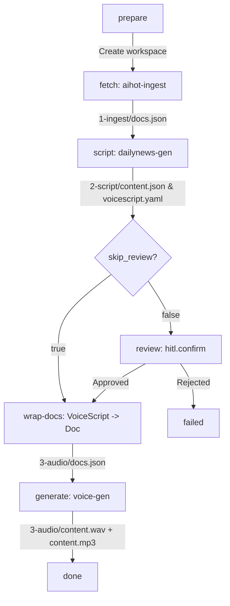

# kk-daily-ai-voice Workflow Design

## 1. Purpose

`kk-daily-ai-voice` (`plugins/kk/workflows/kk-daily-ai-voice.yaml`) is an automated knowledge-kit product pipeline that ingests curated AI news, compiles a spoken broadcast script, and synthesizes audio via `voice-gen`.

## 2. Architecture & Data Flow



## 3. Invocation

```bash
spur workflow run plugins/kk/workflows/kk-daily-ai-voice.yaml \
  --vars '{"work_dir":"/tmp/ai-news-today","limit":"10","language":"zh","voice_profile":"Robin","transcode_mp3":"true","skip_review":"true"}'
```

## 4. Pipeline Artifacts Layout

Within `${vars.work_dir}`:
- `1-ingest/source.json`: Executor-compatible Aihot input (`limit`, optional cursor/state path).
- `1-ingest/docs.json`: Fetched news articles formatted as `Doc[]`.
- `2-script/content.json`: Generator `Content` with VoiceScript YAML body and references.
- `2-script/voicescript.yaml`: Human-readable VoiceScript for inspection or manual edits.
- `3-audio/docs.json`: VoiceScript wrapped as a single `Doc` for `voice-gen`.
- `3-audio/content.json`: Synthesized audio `Content` metadata.
- `3-audio/content.wav`: Concatenated audio broadcast.
- `3-audio/content.mp3`: (Optional) Transcoded MP3 audio when `transcode_mp3: "true"`.

The workflow passes only the generic executor flags (`--in`, `--out`, optional `--plugins-path`).
Daily-news language/title/profile are inherited environment values for the plugin process. The
default `voice_profile` is `Robin`; review approval requires the explicit answer `yes`.
