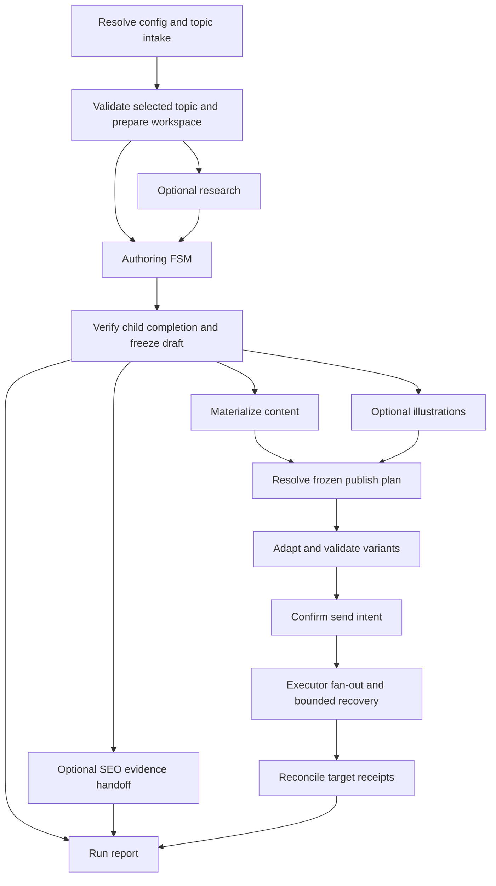

# kk-itc refactor

## Intent and preservation contract
Refactor kk-itc into a top-level dependency DAG with a bounded authoring FSM. Preserve direct topic/file entry, authoring files, bounded revision loops, existing command aliases, image spending opt-ins, live-send confirmation and Board capture. Default empty publishing targets still means author only. Ingestion remains optional. The original discovery and source findings are in [the brainstorm](../plans/2026-10-15-kk-itc-refactor-brainstorm.md); G21 scenarios are the observable contract.

## Alternatives and choice
A table-only cleanup keeps policy duplication. A pure FSM minimizes topology changes but serializes independent production branches and hides their dependency contracts. A pure DAG cannot represent a bounded back-edge without manually duplicating revision nodes. Choose a DAG with one authoring FSM: DAG owns phase dependencies and concurrency; FSM owns topic-independent outline/draft/review/revision state. This revises the initial pure-FSM recommendation in response to the operator's wider standardization and SEO scope. Reuse ADR-031's existing nested-workflow pattern; no new engine, service, package or plugin kind.

## DAG and authoring FSM (planned)



This graph shows dependencies, not a claim that every optional node executes. In author-only mode publication nodes skip, and reporting still depends on a mandatory completed draft-verification node so all-skipped publication cannot suppress the report. Nodes have one action, with data exchanged through immutable run-local files. Dependent consumers validate predecessor digests rather than read concurrently mutated vars. Declare nodes topologically even if a newer runtime can settle reverse-declared skip chains. Group independent file producers; serialize shared output paths, browser resources and send-confirmation boundaries. Keep per-target publishing inside the existing kk executor, rather than generating YAML nodes per channel.

The authoring child contains outline alternatives/selection, draft writing, optional unslop, reviewer judgment and bounded manual/auto revisions. Direct callers retain their existing artifact paths. The child does not publish. Top-level publication can start only after a completion artifact bound to parentRunId, childRunId, executed definition and draft digest is valid. `paused`, `failed`, `cancelled`, absent output and nonzero exit are distinct; launch success never establishes completion.

**Interactive continuation:** the workflow-run entry owns orchestration and follows the exact recorded child ID through each child outline/review/input pause; it never launches a replacement child. In interactive mode the DAG has an explicit authoring barrier that remains paused while the entry continues the child. The entry resumes the parent only after the child reaches its declared successful terminal and the draft receipt validates. A direct premature parent continuation reaches a deterministic child-completion check and refuses. Auto mode uses the same child FSM and completion check without operator pauses. Capture run/continue results via supported structured CLI output; a paused child exit is persisted as a waiting outcome, never silently treated as a terminal success. Resolve nested definitions through the package/workflow resolver and clear only the known nested-Spur environment guards, following existing KK practice.

Persist a deterministic child ID derived from the parent and stage before child launch (`workflow run --run-id` exists). If the child already exists, inspect its persisted status and attach/continue it; a collision is not permission to create a new ID. A crash between launch and receipt creation is resolved by reading that same ID. Mark DAG `resumeRerun` only for nodes proven idempotent or deduplicated; confirmed sends are never marked replayable merely to satisfy engine resume admission. The implementation must test initial child pause, multiple child pauses, parent interruption, cancellation and failed child outcomes against the selected Spur runtime before enabling the new entry path.

A DAG is fail-fast for hard contract failures. Optional SEO/unavailable enhancements produce typed availability data and exit successfully so core authoring continues; publication failure remains explicit per-target data until reconciliation. Do not promise a final report after abrupt failure/cancellation: preserve validated partial evidence and let the existing ledger recovery cover terminal runs. Cancellation must reach an active nested child and its descendants; no detached child may outlive its owning run.

Sources verified 2026-10-15 (HIGH): ADR-031; `plugins/kk/workflows/kk-daily-ai-voice2.yaml:493`; selected CLI `workflow run/continue --help`; engine source `@gobing-ai/ts-dual-workflow-engine@0.5.28`, `src/dag.ts` (`assertDagResumeAllowed`, dependency completion and pause sequencing). A deterministic marker-only probe on 2026-10-15 passed the two-child-pause/parent-continuation sequence and refused premature parent continuation in an isolated Spur project; zero agents or publications ran. This verifies the coordination pattern, not a production ITC DAG, cancellation or crash recovery. The shared-repository attempt encountered SQLite writer contention; isolate verification databases rather than stopping unrelated processes.

## Ownership
| Owner | Responsibility |
| --- | --- |
| Spur workflow | DAG dependencies and concurrency; nested FSM bounded author/review loops; operator pauses, continuation and terminal routing |
| Spur decision catalog | Semantic topic/outline/preset recommendations and source/default provenance |
| kk stage/application | Validate artifacts, resolve plans, adapt input envelopes and summarize exact expected outcomes |
| kk executor | Kind validation, discovery, plugin process lifecycle, fan-in/fan-out, isolated target dispatch and persisted retry aggregation |
| Product publish plugin | Supported publishing operations, locale/format/size/media requirements, mode metadata, site readiness, auth state and observed Result |
| kk bot + publish-harness | Named browser profile lifecycle and shared leases; plugin probe remains readiness authority |
| Topic preset | Editorial audience-to-channel selection; never cookies, selectors, credentials or permission to go live |

## Publication capability contract (planned)
Add optional `publishing` to publish manifests and PluginRecord, validated in kk-core and preserved through discovery/packaging. This is distinct from existing `operations` (auxiliary input/output forms), which remains untouched. A plugin without `publishing` keeps working through executor; the ITC planner refuses unsupported planning with a named explanation rather than guessing.

```json
{
  "publishing": {
    "defaultProfile": "article",
    "profiles": {
      "article": {
        "format": "article",
        "locale": "source",
        "requires": {"cover": false},
        "modes": {
          "draft": {"metadata": {"published": false}},
          "live": {"metadata": {"published": true}}
        }
      }
    }
  }
}
```

`profiles` is a nonempty record of safe profile IDs. `defaultProfile` must reference a declared profile. ContentSchema.format currently accepts strings (schemas.ts:17); profile format is a nonempty string and does not narrow the generic Content contract. Locale is `source` or a validated language tag. Optional `limits` uses the existing content-limit units, never an invented character count. `requires` may declare cover/ordered-images requirements; media generation remains explicit. `modes` is a nonempty subset of `draft|live`; each metadata map is JSON data with a complete mode binding for that profile. Plugin implementation still independently validates its input and live policy. Capability data cannot execute commands or contain credentials. Unknown keys in the new subobject fail validation.

Profiles represent existing channel operations, not new plugin instances: for example X article versus post, Weibo article versus post. Metadata is transcribed from each implementation; do not infer it from examples. Existing script-backed built-ins run through executor dispatch without a redundant execution enum. Actual agent-only plugins remain unsupported by ITC automation until they expose a deterministic invocation contract; no speculative agent fallback is added.

`browserSession` remains the existing optional profile descriptor. The planner derives `--serial-target` from shared browser resources, conservatively serializing browser channels through the existing executor option. It never equates transport=browser with an agent requirement. API-only targets never load browser helpers.

Keep `plugins/kk/scripts` node-builtin-only under ADR-018: resolve this contract in a native application handler for the existing `kk stage run itc-publish-plan` stage, using kk-core discovery. Move the stage's channel table out of the script entirely; remaining filesystem-only helpers consume the validated plan. No sibling deep import, new package or new public command noun.

## Shared configuration and workspace standard (planned)

Use the existing `resolveKkConfigPath()` convention: `KK_CONFIG` override, otherwise `~/.config/kk/config.yaml`. Configuration is read once before mutating the workspace. A missing config uses compiled defaults; an existing unreadable, malformed or wrong-typed config fails clearly rather than falling back into an unexpected directory. Do not overwrite or migrate the operator's config as a side effect of a run. Reuse the existing resolver/path-expansion behavior and extract a shared resolver only where the ITC launcher and native stage need the same contract; avoid another independent shell/YAML parser.

For declared ITC options, precedence is explicit launch flag > declared environment override > `workflows.kk-itc` config > applicable existing global `defaults` > compiled defaults. Do not invent environment names for every option: retain `KK_CONFIG`/`KK_WORKS_DIR` and existing plugin env forwarding. Reject undeclared keys inside the new ITC block, while retaining unrelated existing top-level/plugin configuration. The runner passes one validated effective-options JSON to prepare and freezes its non-secret values/digest in a run manifest. Resume reads that snapshot; changed ambient config cannot silently alter mode, workspace, target preset or spend. Changing effective inputs starts a fresh run or an explicitly identified revision and invalidates affected receipts.

Planned ITC-specific config shape:

```yaml
works_dir: /path/to/.works
workflows:
  kk-itc:
    writer: itc-generating
    playbook: generic
    source_locale: en
    research: false
    judge: false
    unslop: false
    auto: false
    max_revisions: 2
    topic_profile: ""
    publish_preset: ""
    workspace:
      dated: false
    seo:
      mode: "off"
```

These are declared defaults, not an instruction to rewrite the user's current file. Explicit per-option launch flags win; explicit launch `--auto` supplies research/judge/unslop=true ahead of lower-priority config defaults. When auto comes only from config, explicit per-option config values win and the auto policy fills omitted values. Live publication and image spending retain explicit launch authorization and are never enabled by a semantic choice or a generic auto/config flag. Plugin credentials remain in the existing plugin environment seam and never enter the effective-options snapshot. Config errors name keys/types without printing secret values.

Default allocation is `{works_dir}/{workflow-name}/{topic-name}/`, optionally followed by `YYYYMMDD/`. Here workflow-name is `kk-itc`; topic-name is the deterministic safe topic slug. The operator's current config resolves the root to `/Users/robin/xprojects/knowledge-kit/.works`, giving `.works/kk-itc/<topic-name>/`; do not hardcode this machine-specific path into product code. Preserve explicit `--dir`/work_dir as a full workspace override. `KK_WORKS_DIR` overrides the root, not the workflow/topic suffix. Resolve a relative works_dir against the config file's directory, then canonicalize it once; resolve explicit relative --dir against launch cwd. Expand only documented home prefixes, never evaluate shell substitutions.

`workspace.dated` defaults false. When true, derive one local-calendar YYYYMMDD from recorded launch time and timezone; an explicit `--run-date YYYYMMDD` enables the date suffix and wins. Validate actual calendar dates. Resume reuses the original path/date across midnight and timezone changes. Repeated same-topic/date launches refuse an occupied workspace by default; explicit force/resume must preserve confirmed remote receipts and refuse concurrent ownership, never silently reset send evidence. Do not append random suffixes that violate the declared layout.

Reuse a deterministic slug rule across launcher, preparation and Board binding: keep existing ASCII topic slugs stable; support normalized Unicode letters/numbers for non-English topics, collapse separators and reject traversal/control characters. File mode derives the topic from H1 or basename; collected mode resolves the topic before composing its final workspace. Before collected selection, scratch lives under the parent run directory, then validated pool/topic evidence is copied into the final workspace before authoring. Record display title separately from the slug. Use the same effective works root in Board trust/capture; explicit workspaces outside that trusted root retain existing capture refusal behavior.

Standardize the related run envelope at the same seam: canonical workflow/child identities, locale/writer/playbook, launch date/timezone, source/evidence digests, selected preset, artifact paths and terminal/availability vocabulary. Preserve old public artifact filenames and stage aliases. Keep settings metadata, documentation, installed resolution and Board consumers synchronized. This standardization is scoped to ITC and shared helpers it actually uses; it does not rewrite unrelated workflow configurations.

## Entry and topic discovery (planned)
Existing topic and `--in` modes are unchanged. Add `--from-collect <topic-profile>` as a third mutually exclusive input mode, plus explicit `--refresh-collect`. Direct topic/file mode may carry `--topic-profile <slug>` as editorial/preset context without collecting. Reject `--refresh-collect` outside collected mode and reject multiple source modes before mutation.

Collected mode reads a fresh run-local pool using existing `kk store extract --topic <profile> --out <file>` and existing topic-scoped deduplication. An explicitly requested refresh launches the resolved kk-collect workflow through Spur, waits for its real terminal outcome, records child run identity, and only then extracts; never copy its ingestion nodes or treat async launch as completion. Skipped/locked refresh may use an existing pool only when it meets the recorded freshness policy, otherwise stop. Reuse kk-collect fan-in and store contracts; do not ingest independently inside ITC.

An agent (2026-11: or the deterministic `kk itc candidates` verb) proposes up to five candidate article topics (slots `a`–`e`) from pool Doc[]; candidates carry stable item IDs, source URLs, rationale, and references into the pool. Deterministic validation rejects unknown IDs, empty evidence, absent bodies and invalid URLs. Selection records selected item IDs with `kk store select --topic ... --workflow kk-itc --run ...` before authoring. Known author-only/draft-only completion or safe failure releases this run's selection; a successful live-intent send receipt marks published, while unresolved possible effects retain selection for reconciliation. Draft remote saves are not live publication. Uncertain remote outcomes retain a pending selection for reconciliation. Only this run's rows may be released. Empty pool or unavailable required refresh stops with an actionable result; never invent a topic. Pool age/window is recorded in topic evidence and existing extract flags enforce it.

## Structured semantic decisions (planned)
Add a separate ITC catalog beside kk-items. Reuse `spur decision run ... --evidence <file> --json`, with a fixed choice vocabulary compatible with the installed catalog schema:
- `kk-itc-topic-choice`: `a|b|c|defer` widened to `a…e|defer` (max 5 slots); absent candidate slots are invalid choices.
- `kk-itc-outline-choice`: `a|b|c|defer`, fallback `defer`; the selected file must exist and be nonempty.
- `kk-itc-preset-choice`: `suggested|none`, fallback `none`; suggested refers only to the validated topic profile's preset, never a model-invented channel.

Persist the complete decision result, including source, reason, confidence when present, evidence digest and candidate binding. Degraded/default output never masquerades as a model answer. Under auto, valid recommendations can continue authoring; `defer` stops with selection guidance. Explicit outline/preset/target flags take precedence. Preset suggestions alone cannot enable a send: only explicit targets, an explicit preset, or an explicitly selected topic profile with a configured preset establishes publishing intent. No decision changes live or image spending settings. Keep deterministic validation in kk, not the decision model.

## Topic channel presets (planned)
Extend the existing extraction topic-profile parser with an optional `publishPreset` slug, ignored by query compilation and validated separately. All current profiles remain valid. Presets live in `plugins/kk/publish-presets/<slug>.json` with project overrides at `.kk/publish-presets/<slug>.json`; no new global config root or remote registry. Resolve project then package assets by the existing installed-package resolver, independent of cwd for shipped defaults.

```json
{"schemaVersion":1,"name":"technical-article","targets":[
  {"plugin":"zenn-pub","profile":"article"},
  {"plugin":"qiita-pub","profile":"article"}
]}
```

Precedence: explicit `--targets` replaces all preset targets, then explicit `--publish-preset`, then the explicitly selected topic profile's preset, otherwise no targets. Preserve comma-separated plugin names, resolving each default profile; allow `plugin:profile` for explicit operation selection. Reject empty explicit lists, duplicates with conflicting profiles, unknown/malformed presets, path traversal, absent plugins, incompatible operations and unsupported run modes before any publishing. One profile per plugin per plan retains the existing fan-out identity contract; multiple operations to the same channel in one run are deferred. Presets contain no live or spend toggles. Seed only profiles grounded in current plugins (technical article: Zenn/Qiita; Chinese article: Juejin/InfoQ); do not put XHS in an article-only preset without its image requirements.

## SEO cooperation seam (planned, no dependency on unfinished G9)

The current Smart SEO design (G9/ADR-039) accepts public URLs and emits evidence-backed audits; it does not declare a local-draft input or a product generator plugin. Keep that boundary explicit. G21 reserves a small versioned file contract and a DAG branch; it does not add a new plugin kind, duplicate SEO rules/crawling, or silently extend G9's accepted scope.

`seo.mode` is `off|handoff`, default `off`. In handoff mode, export `seo/prepublish-request.json` after the final reviewed draft is frozen. Its strict envelope is `{schemaVersion:1, parentRunId, contentDigest, locale, title, draftPath, sourceRefs, audience?, intent?, canonicalUrl?}`. Paths are confined to this workspace and sourceRefs are validated provenance. No search volumes, rankings or traffic claims are invented. The packet is a request for a future draft-capable adapter, not a runnable input to today's URL audit. Record `status: not-assessed` with reason `draft-adapter-unavailable` until a compatible provider is shipped; ITC continues unchanged.

After confirmed live publication, include verified public URL(s), target/profile, receipt digest and content digest in `seo/published-pages.json`, allowing the existing G9 public-URL workflow to audit them separately. Draft save URLs, editor URLs, private previews and uncertain sends never qualify. G21 exports the handoff; automatic URL audits, provider networking and new draft optimization are deferred to the SEO owner's compatible delivery. No hard task dependency on G9 is introduced.

Future returned editorial recommendations must identify schema/provider version, contentDigest, locale, evidence/action references and availability. Stale or mismatched responses are rejected; absent or disabled SEO is recorded as disabled/not-assessed, never PASS or zero issues. Any future content edit creates a new draft revision, reruns technical review and invalidates downstream adaptation/planning receipts. SEO never grants publication or spending authorization. The seam therefore supports improving content later while preserving ITC's current review and send boundaries.

## Frozen plan and target payloads (planned)
Version publish-plan.json additively. Retain top-level live/sourceLocale/variants/fanout/browser fields while Board readers migrate; browser becomes an empty legacy field after all shipped targets use executor dispatch. Add schemaVersion, planDigest, capability digest, source content digest, preset provenance and explicit target rows. Hash stable canonical content plus profile/operation/mode/requirements; reuse existing digest helpers where available.

Each target row identifies plugin, profile, variant, payload path, mode, browser resource key, capability binding and expected Result path. Variant sharing depends on locale, format AND limits/media requirements. Share only immutable editorial content; materialize distinct target payloads with plugin-declared mode metadata immediately before dispatch, never Object.assign several target switches into one shared variant. Strip stale publication/operation fields before stamping the selected profile's complete binding; preserve editorial metadata and source evidence.

Use existing executor fan-out for compatible payload groups; when metadata differs, groups contain a single target rather than inventing a per-target executor API. Keep fan-out retry ledgers and successful metadata carry-forward. Existing concurrency controls serialize shared browser profiles. Adding a compatible test plugin plus manifest/preset must require no YAML or centralized channel-table edit.

## Readiness, send and recovery (planned)
`kk bot list` is an optional operator inventory, not an authentication check. Before sending, call existing plugin check for declared probe entries and let each plugin enforce its own rate limits/challenges. Return plugin-owned bot login/open guidance; do not automatically login, logout, create profiles or repeat expensive probes. Live always requires explicit launch intent and the existing send confirmation; auto only permits configured drafts. Unsupported draft modes fail rather than promote to live.

Bind each receipt to planDigest, target, payload digest and invocation attempt. Strictly validate all input/output schemas and reconcile exactly one outcome per expected target. A missing/malformed/stale/duplicate/extra Result is a contract failure. Existing invocation stale-output deletion and Result.ok=false behavior stay at the executor seam. Reporting must not reinterpret absent runtime evidence as PASS. Dry-run is explicitly identified and cannot generate publish-ready receipts.

Recovery budget remains at most one workflow retry for publication and the existing revision counts. Confirmed success is carried forward without resend. Repeat-safe failures can retry through existing --retry-from. A crash/timeout after possible remote submission is uncertain unless plugin evidence proves no effect or supplies an idempotent remote recovery; require manual reconciliation and preserve evidence. No exactly-once claim. Source content, mode or plan identity changes invalidate automatic reuse. Preserve valid partial results and write reports through routed failures where artifacts remain writable; abrupt process death remains recoverable from receipts, not a promised final report.

## Input handling
Operator topics, file paths, preset names and target lists remain data. Use argv/file/environment contracts at the current launcher and stage seams. Validate slugs and safe relative artifact paths, quote resolved path reads, and remove direct substitution of arbitrary topic text into shell code. Tests must include spaces, quotes, backticks and dollar substitutions, with a marker proving no command evaluation. No credentials or full browser content enters decision evidence or reports.

## Compatibility and verification
- Keep existing draft/outline/report/Board locations and teach readers additive schema fields without reinterpreting historical reports as new receipts.
- Preserve legacy stage spelling aliases while new YAML uses stage run; update installed runner, publish and article-adapt skills, packaging assets and tests together.
- Existing 62 focused tests pass their assertions (2026-10-15); scoped run exits 1 from shared-module coverage, so this is not a full gate certificate.
- Add behavioral tests for collected/empty/refresh failure, decision degradation, preset precedence/unknowns, mixed target metadata, expired/challenged bots, partial/stale Results, uncertain retry, and input shell metacharacters.
- Exercise fake transports and a manifest-only extra plugin from outside the checkout. Never require live accounts or spend for this suite.
- Final implementation checks: bun run lint, bun run test, bun run build, scoped Spur rules and feature/task checks, plus intentional git status. Planning checks do not certify product completion.

## Decomposition and budget
Six deliverables, estimated 52h total: plugin capability planning (8h), collected topics (8h), presets (6h), structured authoring decisions and child FSM (8h), DAG dispatch/recovery and SEO handoff (12h), configuration/workspace and compatibility integration/docs (10h). Source files shared across slices execute in dependency order. Each task carries its own implementation and tests; final integration owns only cross-slice coverage and doc synchronization. Parent rubric E52 D6 L5 C2 R2 = 67, forced split by effort and publication risk. No code implementation occurs in this design run.


## Ready-depth interface freeze — 2026-10-15

The source audit and per-task handoffs are recorded in [the ready-depth report](../plans/2026-10-15-g21-refineall-ready.md). New type/function/stage names below are implementation contracts, not claims that they already exist.

| Owner | Frozen output / responsibility | Consumers |
| --- | --- | --- |
| 0298 | PublishingProfileSchema / PublishingCapabilitiesSchema, PluginRecord.publishing, buildItcPublishPlan in apps/cli/src/itc-plan.ts; async runItcStage in itc-stage.ts from commands/stage.ts | 0300 preset selection, 0302 send plan, 0303 effective options |
| 0299 | Native itc-topic-extract/validate/select/selection-settle; topic-pool, topic-candidates and chosen-source JSON with run/digest membership | 0300 topic profile, 0301 candidate choices, 0302 settlement, 0303 workspace |
| 0300 | ExtractProfile.publishPreset parser extension; resolveItcTargets; strict project/package preset precedence and provenance | 0301 suggested preset, 0302 frozen plan, 0303 config defaults |
| 0301 | kk-itc-author.yaml child FSM, itc-decision handler and .itc/author-run.json / author-complete.json | 0302 parent barrier and 0303 entry/Board child authority |
| 0302 | Root DAG, isolated target payload/receipt processing, exact result reconciliation and optional SEO handoff | 0303 final entry/settings/Board integration |
| 0303 | Strict itc-config.ts options/workspace resolver, standard entry and parent/child Board reading | final installed operator surface |

0299 depends on 0298's native dispatcher; the remaining order is unchanged. Early helpers accept explicit requests and work directories; they do not import or stub the later 0303 config resolver. Keep existing runStage synchronous for daily callers; only the native ITC command branch is awaited. Existing builtin-only script entry compatibility forwards by argv to the intercepted native command. No general router service is introduced.

Profile limits are optional title/body {max,unit} using ContentCountUnit. Clear the union of profile mode keys before stamping a complete selected binding. Qiita requires private:true plus published:false for nonpublic draft mode, and private:false/published:true for live; private otherwise wins. Current WeChat article uses operation=文章 and publishStatus=draft|public, not historical operation=draft. XHS 上传图文 requires ordered metadata.images; a hero cover alone is insufficient. Plugin-local validation remains authoritative.

The preset resolver's complete precedence is explicit targets > explicit preset > resolved workflow-config preset > explicitly selected topic profile preset > no targets. Exact duplicate plugin/profile selectors collapse; conflicting profiles for one plugin fail. Extend the real kk-store parseProfile/PROFILE_KEYS/ExtractProfile boundary without changing compileProfile SQL. Malformed project overrides do not fall back to package assets.

Decision evidence is explicitly compacted to <=1800 UTF-16 units per file, within Spur's 2000-character bound. Persist served JSON because decision run does not write a resultFile; validate source/default and candidate binding independently of exit 0. Config auto and explicit launch auto have distinct precedence as specified above; no new generic environment override namespace is added.

Receipt/SEO observations must distinguish requested mode from executor success. Aggregate status published means a successful invocation, including draft saves; Result.target may be a channel label whereas aggregate target identifies the requested plugin. Failed Result metadata is currently dropped by fanout.dispatchOne; 0302 preserves it when using typed delivery evidence instead of parsing errors or weakening all retry selection. The reserved optional Result.metadata.itcDelivery object is {schemaVersion:1,effect:none|confirmed|unknown,publicUrlVerified?:boolean}; missing evidence is unknown. Only proven effect-none failures enter an explicit safe retry subset. A composed Result URL never establishes public visibility. Public SEO URL handoffs require explicit live intent and verified public evidence; absent proof yields not-assessed.

Config resolution is two-phase for collected topics: validate/freeze intake defaults with workDir:null before ideation, then finalize the selected topic's prepared workspace/snapshot. Reject malformed config/source before mkdir or counter writes. Missing ITC config uses read-only defaults; other workflows retain their existing behavior. Force is a fresh identity and never silently deletes send receipts. A resume keeps its original path/options but cannot expand current Board trusted-root authority.

The Board's existing ITC revision projection reads FSM state visits; after migration the parent DAG uses action rows and the author child supplies authorized progress. Bind child ID/definition/options/draft evidence before fetching child progress through existing run endpoints; missing authority stays unavailable/null, not synthetic zero. Retain historical FSM captures. Final implementation must exercise actual validators, store/executor boundaries and isolated real Spur continuation; the earlier marker-only probe does not certify production cancellation or crash recovery.

## Known harness limitation — DAG mid-run fresh start (recorded 2026-10-18)

Spur 0.4.x offers no engine-side way to start a DAG run at a chosen node: `startable` is not a
DAG node key (`spur workflow validate` refuses `nodes.N: Unrecognized key: "startable"`) and
`--from <node>` is refused for `kind: dag` (`not supported for kind: "dag" workflows — DAG runs
resume at node level instead`). The verified re-entry seam is therefore the separate
`plugins/kk/workflows/kk-itc-publish-tail.yaml` definition (task 0310), not a marker on the main
DAG. If the engine later ships fresh-start support, the tail definition can be retired in favor of
it; until then this note is the standing record (operator directive 2026-10-18: no deferred corpus
task for this item).
