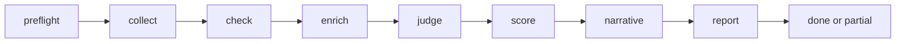

# Smart SEO workflow

Accepted design, not implemented. The operator invoked `sp-dev-idea --auto --agent inline`; this document freezes the recommended scope for task execution. [Vendor review](../plans/2026-10-14-smart-seo-vendor-review.md) and [approach comparison](../plans/2026-10-14-smart-seo-brainstorm.md) supply the evidence. ADR-007/011/016/018/036/037 constrain the ownership and runtime choices.

## 1. Outcome and boundaries

A public URL produces a read-only technical SEO audit, semantic/editorial SEO/GEO review and prioritized action plan. JSON is the source of truth; Markdown is a deterministic projection with an optional validated narrative. The agent can also interpret a saved audit through one fat skill. Model judgments never establish indexing, ranking, traffic, revenue, bot behavior or citation visibility.

No live site/repository edits, search submissions, publishing, account changes, paid DataForSEO adapter, browser rendering, continuous monitoring, PDF/XLSX, scheduler or Board module in v1. No Python, native rendering stack, new package or dependency. `vendors/` is reference-only and is excluded from runtime/install resolution.

## 2. Ownership and affected paths

| Owner | Paths and responsibility |
| --- | --- |
| Spur | State sequencing, action trace, configured maker selection, `spur decision` contracts. No engine changes. |
| KK workflow | `plugins/kk/workflows/kk-smart-seo.yaml`: native stage calls, one bounded narrative action, terminal outcomes. |
| KK deterministic stages | Existing `plugins/kk/scripts/kk-workflow-stages.ts` lazily dispatches `seo-*` to `seo-stages.ts`. Siblings `seo-fetch.ts`, `seo-facts.ts`, `seo-rules.ts`, `seo-decisions.ts`, `seo-enrich.ts`, `seo-report.ts` hide their substantive work. Builtins only, matching existing script distribution (ADR-018). Do not introduce generic service layers. |
| Catalogs | `plugins/kk/decisions/kk-seo-site.yaml`, `kk-seo-page.yaml`, `kk-seo-pair.yaml`, `kk-seo-keyword.yaml`; all directly in the registered root. No assumption of recursive catalog loading. |
| Agent entry | `plugins/kk/skills/smart-seo/SKILL.md` plus `references/{operations,method,seo-geo-sources,narrative}.md`. One fat skill; no new command, subagent or product plugin kind. |
| Attribution | `plugins/kk/references/smart-seo-attribution.md`: upstream MIT notice and adapted code/rubric attribution. No bundled font assets. |
| Tests/distribution | `plugins/kk/tests/smart-seo-*.test.ts`, fixture directories under the same tests root; stage/installed-package tests under `apps/cli/tests/`; `scripts/tests/` only if packaging needs extension. Existing stage resolver, bundle and package allow-list remain the first reuse choices. |
| Documentation | `docs/04_DESIGN.md` index/surface, `docs/03_ARCHITECTURE.md` accepted-design pointer, `docs/01_PRD.md` scope, `docs/02_ROADMAP.md` sequence, `docs/05_FEATURES.md` status. Same-change updates as each slice ships. |

Source inspection confirms `stage run` is already registered in `apps/cli/src/commands/stage.ts`; AGENTS' planned-surface note lags that code. Use the registered verb and preserve its aliases. No unrelated documentation cleanup is part of this feature.

## 3. Invocation and state flow

Workflow name `kk-smart-seo`, schema version `2`, kind `state-machine`, initial `preflight`, terminal `done|partial|failed`. `done` means requested stages assessed their eligible evidence, not that the site has no SEO issues. `partial` is successful artifact delivery with missing requested evidence; it is not a failure state. `failed` is the sole failure state.

Every required state has an `action-ok` edge to the next state and an `always` edge to `failed`. Optional enrichment/maker failures are persisted as availability outcomes and the stage exits 0. Report chooses `done` or `partial` by validated `report.json.status`; an absent/malformed report routes to `failed`. `iterationBound: 12` covers the eight stages plus terminal with no open loop. Narrative has no agent-controlled revision loop: use a fresh `agent.run`, `answerFile` at the run's `narrative.json`, `timeoutMs: 120000`, `onError: continue` and an unconditional transition to report; missing or invalid output becomes a labeled deterministic summary. Avoid `type: parallel`; helper loops are sequential and bounded.

All deterministic actions expand quoted environment variables as data: `kk stage run seo-<stage> "$work_dir"`; workflow preflight uses `kk stage run seo-preflight "$work_dir" "$options_file" "$__runId" true`. Never template user values into shell source with `${vars.…}` and never eval them. The skill writes options JSON, then passes its path as data; spaces and shell metacharacters in paths remain literal arguments, while NUL input is refused. Use existing workflow environment rules for `kk`/Bun/PATH and PSI/CrUX credential names; no provider secret appears in vars, audit files or prompts. Preflight atomically writes `.spur/run/<run-id>-seo-work-dir.txt`; `file.read.into-var` loads that exact run-bound file into `work_dir` before collection.

| Input | Default and validation |
| --- | --- |
| `options_file` | Required path to UTF-8 JSON; max 64 KiB; strict object below. |
| `work_dir` | Empty asks preflight to allocate `.works/kk-smart-seo/<UTC-stamp>-<run-id>`; fixed resolved path projected with `file.read.into-var`. Explicit directory must be absent/empty; refuse overwrite. |
| `url` (in options) | Required HTTP(S) or bare domain; bare becomes HTTPS. Reject userinfo, nonstandard ports, local/reserved addresses and malformed hostnames. |
| `locale` | `en-US`; BCP-47 validation. Describes report audience and imported query market; never assumes the site's language. |
| `business_context` | Empty; max 2,000 UTF-16 units, optional audience/offer/desired-indexing intent. Treat as operator context, distinct from website evidence. |
| `max_pages`, `max_depth` | 60 and 5; positive integers, hard maxima 200 and 10. Page quota counts all page attempts including blocked/redirect/error records. |
| `max_requests`, `deadline_seconds` | 200 and 600; hard maxima 500 and 1800. One quota/deadline shared across robots, sitemaps, pages, probes and link targets. |
| `semantic_pages`, `max_pairs`, `max_keywords` | 20, 10, 10; maxima 60, 40, 30. Deterministic selection by homepage, observed depth/inlinks, URL tie break. |
| `max_decision_calls` | 320; maximum 1000; every attempt consumes one. No retry on a paid/unknown-charge decision. A truncated plan is explicit partial assessment. |
| `performance` | `false`; true requests PSI mobile/desktop and CrUX for at most 3 deterministically selected pages. Enrichment shares its own 300-second stage deadline and 12-call cap. |
| `visibility_file` | Empty; optional normalized local JSON snapshot described in §8, never arbitrary provider dump. |
| `fixture` | Empty; explicit offline fixture directory path. With fixture, network and real maker dispatch are forbidden. Production never silently falls back to fixture data. |

No maker override in v1. Effective makers are owned by Spur config. Collection-only stage use requires no catalogs; workflow preflight passes `require_decisions=true` as a fourth positional argument and checks `decision status --json`/`show` once, recording registration/configuration without equating it with model health. That argument defaults to false for direct collection. Missing SEO contracts are a required workflow preflight error with a specific registration command/config pointer. Explicit offline fixture mode checks local fixture contracts and never invokes a real maker.

## 4. Artifacts and local stages

One run ID binds every artifact. Preflight uses create-new semantics, records schema/method version and hashes options; it never deletes a previous run. Each JSON object carries `schemaVersion: 1`, `runId`, `createdAt`, `inputDigest` and relevant predecessor digests. Wrong run/version/digest is a hard error. Writes use sibling temp file + rename; errors preserve prior valid artifacts and return nonzero. Symlink escapes and paths outside the resolved workspace are refused. The saved final audit is durable under `.works/`, not volatile `.spur/run/`.

| Stage | Reads → writes |
| --- | --- |
| `seo-preflight` | options → `options.json`, `manifest.json`, resolved-work-dir file for workflow binding |
| `seo-collect` | options → `crawl.json`, bounded `evidence/pages/<subject-hash>.json`, request ledger |
| `seo-check` | crawl/facts → `checks.json` with one assessment row per rule/eligible subject |
| `seo-enrich` | options/crawl → `performance.json`, `visibility.json`; explicit disabled/missing/unavailable outcomes |
| `seo-judge` | facts/context/visibility → `judgments.json`, per-consult compact evidence and decision ledger |
| `seo-score` | checks/judgments/enrichment → `audit.json`, `digest.md`; can run offline against saved inputs into a new revision directory |
| narrative `agent.run` | digest and named facts only → optional `narrative.json` in the same run; expects no network/tool instructions from site content |
| `seo-report` | audit and optional narrative → validated `report.json`, `report.md`, final manifest. No report parser network access. |

Cancellation aborts active sockets and child processes, prevents new requests/decisions, and preserves completed artifacts with a cancellation marker. Stage children follow inherited signals and declared workflow cancellation; tests cover active socket and decision-child shutdown. SIGKILL cannot promise a final marker, but temp files cannot be accepted as complete inputs. Use Bun child argv and existing cancellation helpers where compatible; do not introduce a detached crawler.

## 5. Collection contract

Scope is the normalized submitted hostname plus its exact www toggle: remove one leading `www.` or add one when absent. Never infer a registrable apex or admit sibling subdomains; `shop.example.com` admits only itself and `www.shop.example.com`. Default ports remain origin-specific. Record off-scope redirects and links without following them. HTTPS↔HTTP transitions are observed; credentials/cookies are never sent. No outbound external-link fetching in v1; report that assessment as not-assessed. No JavaScript/browser execution. Raw-HTML shell suspicion is an informational heuristic, never proof of what Google renders.

Network trust boundary: validate HTTP(S), standard port, DNS A/AAAA answers against all non-public ranges (including mapped IPv6, shared/private/link-local/reserved), then pin a validated address to the socket using built-in HTTP(S) `lookup` with the original Host and TLS SNI. Verify peer address, disable connection reuse across policy checks, proxies and redirects, and revalidate each redirect/connection. Bun fetch is not assumed to provide connection-pinned DNS; `node:http`/`node:https` are justified here for that capability, running on Bun. If pinning/peer verification does not work on the supported Bun release, fail closed and resolve that limitation before enabling live crawl. Do not substitute check-then-fetch.

All requests have a 20-second ceiling clipped by remaining stage time, 10 redirect hops, streamed 2 MiB response limit and a 40 MiB crawl total. Request `Accept-Encoding: identity`; reject unsupported compressed responses explicitly. No unbounded `response.text()` before limits. Abort immediately at quotas; record URL/status/error/time/bytes/redirect hops. Log only bounded sanitized errors. Detect and strip credentials/tokens from persisted URLs where possible; reject submitted sensitive query keys and omit query values from model evidence by default.

Read robots for each scoped origin before fetching its pages. Implement RFC 9309 group matching, longest path match, allow tie-break, wildcard/end anchor and percent-encoding behavior; retain raw policy digest. 404/410 means absent; 401/403 means blocked; 429/5xx/network/malformed policy means unavailable and do not fetch dependent pages. Redirect rules remain scoped and public. Respect full `Crawl-delay` for this audit UA even though it is an extension; when remaining time is insufficient, mark budget exhaustion rather than shorten it. No bot protection bypass. AI bot diagnostics use each page path, not just `/`.

Sitemaps: bounded same-scope `urlset`/`sitemapindex`, up to 25 files, 5,000 discovered URLs and queue length 5,000. A small non-expanding XML-subset reader handles XML declaration, comments, standard/default namespace, `loc`, optional `lastmod` and standard XML character entities. Reject DOCTYPE/custom entities, malformed nesting, unsupported namespace constructs and compressed inputs as unknown; no regex-only XML extraction. Tests must cover accepted and refused fixtures. This deliberately limited reader replaces a dependency, not a general XML parser. `shortcut: uncompressed standard sitemap subset only, use a maintained bundled XML parser if broader formats become required.`

Use Bun `HTMLRewriter` for bounded facts extraction. Preserve title/meta/robots/canonical/hreflang, H1-H3/outline, visible main/article text, link/anchor/image summaries, JSON-LD syntax/type inventory, headers and timings. Buffer text per element to accommodate streaming callback chunks. Fallback body extraction removes chrome conservatively and labels it. JSON-LD is data; cap its size/depth/nodes and never fetch contexts. Preserve original URLs and slash distinctions; drop fragments only. Word count is an editorial measure with language limitations, not a quality verdict.

## 6. Rule and scoring method

The review's appended 52-row disposition table is exhaustive. Native facts and rule findings retain the vendor's useful rule identities; adapted behavior follows V01–V18. Every check row: `{ruleId, subjectId, status, category, severity, evidenceRefs, sourceUrl, sourceCheckedAt, heuristic, reason}`. Status is `pass|fail|unknown|not-applicable`; absence of a row is an error, never a pass. Crawl-limited orphan/depth/duplicate observations explicitly say "among sampled pages". Robots, intentional noindex and canonical-to-other are signals requiring operator intent, not automatic site defects. Missing optional SEO files/metadata do not become indexing requirements.

Findings: stable ID `SEO-<ruleId>-<first12(sha256(canonical subject identity))>`; subject identity is the exact request URL or sorted pair IDs or site scope. Sorting never renumbers. Keep observed fact separate from interpretation and remediation proposal. Every finding carries severity, category, source, heuristic flag, certainty and full affected-subject list; aggregation does not hide unknown subjects.

Technical category score is `100 * pass/(pass+fail)` over applicable assessed rule-subject rows, null if denominator zero. Coverage also reports `assessed/(assessed+unknown)` with explicit counts and disabled areas. This is a versioned internal checklist rubric, not the vendor weighted overall grade. No blended overall SEO/GEO health grade in v1. Semantic dimension aggregates are separate 0–3 means using only model-sourced, sufficient-confidence results; null if none. Unknown/review values never count as successes.

Action order: severity (`critical`, `high`, `medium`, `low`, `info`), then assessed affected-page count descending, then effort band ascending, then stable ID. Priority P1 is confirmed critical/high; P2 confirmed medium; P3 low; uncertain actions are `review` outside fix-first lists. Effort 1–4 is a declared planning heuristic, not a quote. Editorial scores can justify a review suggestion, never confirm a technical fact. Do not retain vendor's relative 100 impact scale or imply a comparison between runs with different coverage.

## 7. Typed decisions and evidence

Four catalog files, 22 decisions in total:

| Catalog | Decision IDs / types |
| --- | --- |
| Site | `kk-seo-business-model` choice; `kk-seo-value-proposition` score; `kk-seo-entity-clarity` noul; `kk-seo-topical-focus` score; `kk-seo-local-intent` noul |
| Page | `kk-seo-page-type`, `kk-seo-search-intent`, `kk-seo-page-action` choice; `kk-seo-importance`, `kk-seo-helpfulness`, `kk-seo-specificity`, `kk-seo-trust`, `kk-seo-citability`, `kk-seo-title-fit`, `kk-seo-meta-fit` score; `kk-seo-answer-first`, `kk-seo-next-step`, `kk-seo-heading-fit` noul |
| Pair | `kk-seo-intent-overlap` noul |
| Keyword | `kk-seo-keyword-relevance` score; `kk-seo-keyword-other-brand` noul; `kk-seo-keyword-page` choice |

Catalog `version: 1`, schema is Spur's shipped catalog schema. Choice vocabularies adapt vendor descriptions, add `unclear`; page action is `keep-or-improve|rewrite|review-consolidation|unclear`, never automatic removal. Score has four descriptive levels 0–3, fallback 0; noul fallback 0.5; choice fallback `unclear`. `defaults.minConfidence: 0` preserves served model observations rather than silently replacing low-confidence scores. The KK consumer alone separates sufficient confidence from review. Makers remain unpinned.

All decisions declare required `subject_id` and `locale` string params; only keyword-page additionally declares JSON `candidates` (max 30 IDs, titles and URLs; serialized total ≤16 KiB, titles ≤160 characters, URLs ≤2,048 characters). Deterministic candidate truncation is recorded explicitly; oversize params never reach argv. The static keyword-page vocabulary is `existing|new|unclear`; do not try to interpolate dynamic choices into schema keys. Existing-page mapping is validated from a separate bounded per-candidate relevance pass using `kk-seo-keyword-relevance` with keyword/page evidence; include these calls in the global cap, select the strongest sufficient result, and use `unclear` on ties or exhaustion. No untyped URL answer from a model is accepted.

Runtime call is `Bun.spawn([spurBin, 'decision', 'run', id, '--param', 'subject_id=…', '--param', 'locale=…', '--evidence', factsPath, '--evidence', excerptPath, '--evidence', contextPath, '--json'])` with optional declared candidates param. `spur decision run` does not write a workflow resultFile; KK persists its served JSON and ledger. Catalog-driven page loops belong in `seo-judge`, not a state per page or a new hub client.

Spur bounds each evidence file to 2,000 characters. KK must produce each compact JSON packet at ≤1,800 UTF-16 units (site context ≤1,000), verified after serialization. Text packet has original length, retained length and truncation flag; header/fact references stay in a separate packet so truncation never silently removes metadata. Use summary selection of the main opening and a later passage when space permits; never send an entire audit as one evidence file. Website strings are marked untrusted observations and cannot supply instructions. Test payloads beyond 2,000 chars and multibyte text; do not depend on leaked ancestor libraries or increase Spur's global limit.

Validate returned JSON at runtime: finite in-range value of declared type, nonempty maker/source/reason, confidence null or finite 0–1. Only `source=model` is a model answer. Choice/score confidence ≥0.8 qualifies; missing/lower confidence is review. For noul use served probability ≥0.8/≤0.2, otherwise review, while preserving null confidence. Unsupported source, malformed output, spawn timeout/nonzero and catalog fallback become unknown with reason. The judgment stage has one 600-second deadline; each child has a 30-second ceiling clipped by remaining time, is terminated on timeout/cancellation, and is never retried. Deadline exhaustion leaves remaining questions explicitly unassessed. Do not fabricate probability distributions the CLI does not serve. Preserve raw outcome and the method threshold separately. Skip inapplicable questions, deterministic homepage type, and policy/contact editorial findings when classification is sufficiently certain.

Bound pairs through deterministic title/H1 token overlap, label the shortlist heuristic and multilingual limitation, never treat overlap alone as cannibalization. Page importance/action is advisory, not permission to delete. Call count and duration are measured; USD cost stays unknown unless exposed by a trustworthy provider ledger. No stale price constant or promised monetary hard cap.

## 8. Optional measured evidence

PSI (`PAGESPEED_API_KEY`) supplies mobile/desktop Lighthouse lab metrics. CrUX API (`CRUX_API_KEY`) supplies field p75/window/form factor with URL→origin fallback recorded explicitly. A missing key, insufficient field sample, 429, malformed response or timeout is availability data, never zero performance. Field pass requires all three LCP≤2500ms, INP≤200ms, CLS≤0.1 at p75; missing any is unknown. TBT is lab only. Per-page findings retain every affected page; do not stop after the first field failure as vendor `perf_findings` does.

`visibility_file` shape: `{schemaVersion:1, siteOrigin, locale, source, collectedAt, measurementKind:'measured'|'estimated', rows:[{query, url?, clicks?, impressions?, position?, citations?, sampleCount?, platform?}]}`. Maximum 1 MiB/500 rows, strings bounded, finite nonnegative numeric values, source/locale/date required. URL must belong to audit scope when present. Unknown properties and conflicting locale/site identity fail validation before use. Retain snapshot hash/time and source attribution; future/stale evidence is flagged (older than 90 days). Citations need platform and denominator; rankings are dated snapshots. Keywords are selected from this data, never invented volumes. No live provider or Search Console OAuth integration in v1.

## 9. Narrative and all-in-one skill

Narrative JSON is `{schemaVersion:1, runId, auditDigest, sections:[{heading:'summary'|'priorities'|'limits', claims:[{template:'fact'|'action'|'limit', evidenceRef:{artifact:'audit.json',jsonPointer}}]}]}`. Max 32 KiB/30 claims; reject unknown keys, including free prose `text`. Pointers must resolve respectively to an allow-listed scalar observed fact, an action object, or a recorded limit object. Rendering uses fixed method-owned templates, recorded units and escaped values; agents select/order references but cannot introduce measurements, diagnoses or predictions. Generic JSON-pointer resolution is insufficient: enforce target type and approved collection, refuse prototype keys and reject stale digests or unknown IDs. Reject the entire narrative on any invalid claim, retain its diagnostics and produce a deterministic summary labeled `narrativeStatus: rejected`; optional agent failure is not an audit failure. Arbitrary editorial prose can be discussed by the skill outside the validated report; v1 makes no automatic semantic verification promise.

The skill covers URL intake, preflight/catalog registration, bounded run, progress via workflow traces, checking high-severity evidence, interpreting sources/unknowns, writing a narrative, explaining technical/on-page/content/local/ecommerce/international SEO and GEO implications, and offline rescoring. Specialist topics outside collected evidence are clearly consultation and source-verified; no phantom metrics. Skill references carry source refresh procedure, report contract and examples; keep SKILL.md below its body budget. Capability validation/evaluation uses Superskill's skill lifecycle. No new subagent or slash-command wrapper.

## 10. Packaging and catalog discovery

Reuse `scripts/bundle-plugins.ts` copying of `plugins/kk/` and the shipped stage resolver. Helpers use only Bun/Node builtins; no ancestor module lookup. Workflow and skill references resolve installed copies first according to existing KK/Superskill conventions, never hardcoded checkout paths. Current `superskill install --help` and its install/post-action implementation expose capability/script installation, with no Spur `decisions.paths` merge operation. V1 therefore documents explicit consumer setup: resolve the installed KK package root using its real executable path, append `<package-root>/plugins/kk/decisions` to project `decisions.paths`, and preserve all existing entries and maker settings. Preflight fails clearly until that path serves the SEO contracts; repeat setup if an upgrade changes the resolved root. Do not silently write user-global config during an audit or invent a Superskill flag. A clean consumer acceptance test performs this documented setup, loads catalogs through `decision status/show`, then executes the fixture workflow outside the repository with `vendors/` inaccessible.

## 11. Verification and task sizing

Every slice includes behavior tests and same-change surface docs. Six cohesive tasks: bounded facts collection (12h), offline rule/prioritization/report projection (10h), typed semantic assessment (8h), optional performance/imported evidence (6h), workflow/narrative orchestration (8h), one skill plus installed acceptance (6h). Larger first two tasks share security/parser or evidence/scoring review context respectively; splitting them by code layer would duplicate that context. None exceeds the mandatory 16h split ceiling. Installation acceptance follows integration; it is not a separate test-only task.

Required fixtures: robots missing/blocked/failed/path groups/wildcards/full delay; DNS mixed public-private/rebinding/IPv6/redirect scope; request/body/deadline cap; slash/query-distinct URLs; supported/rejected sitemap syntax; streaming HTML/JSON-LD errors; empty crawl; stable IDs; missing/malformed/default/low-certainty decisions; 2,000+ char evidence; prompt injection content; literal shell metacharacters in options/workspace paths; PSI URL/origin/missing metrics; locale/import mismatch; narrative invented value/ID/digest; cancellation; packed fixture run outside checkout. Offline tests make no paid calls. Real end-to-end audit remains an operator-run validation after implementation, with source, coverage and maker limitations reported.

Run `spur workflow validate`, catalog `decision status/show` with isolated config, Superskill skill validate/evaluate, fixture workflow, installed-package acceptance, then project lint/tests/build/rules. No test skips or gate suppressions. This planning run validates the feature/task corpus and docs; implementation tests are owned by the six tasks.

## 12. Primary sources

Source registry and current-document conflicts are recorded in the [review](../plans/2026-10-14-smart-seo-vendor-review.md#current-seogeo-sources-verified-2026-10-14). Additionally, [RFC 9309](https://www.rfc-editor.org/rfc/rfc9309) owns robots matching; [Google canonicalization](https://developers.google.com/search/docs/crawling-indexing/consolidate-duplicate-urls) explains canonical hints; [Google robots metadata](https://developers.google.com/search/docs/crawling-indexing/robots-meta-tag) covers noindex/snippet controls. Recheck the primary source when a rule is changed; report checked-at dates and preserve uncertainty when source pages disagree. Vendor self-reported model agreement is not human calibration and does not establish KK model accuracy.

## 13. Implement-ready handoffs (2026-10-14 refinement)

This section corrects the initial ready preparation; task Background correction records preserve the individual findings. Scope and ADR-039 remain unchanged.

- **0281 → all:** owns the shared run envelope and bounded facts validators in `seo-stages.ts`/`seo-facts.ts`. Envelope fields are `schemaVersion`, `methodVersion`, `runId`, `createdAt`, `inputDigest`, `predecessorDigests` (artifact basename → SHA-256), and `status: complete|partial`; payload arrays are `pages`, `requests`, `limits` in crawl, `assessments` in checks, `judgments`, `entries` in performance, and `rows` in visibility. A page has exact request `subjectId`/`url`, nullable HTTP status and facts, `availability: available|blocked|unavailable`, evidence path/hash and redirect chain. Missing facts stay null; empty valid collection is partial, whereas malformed artifacts are fatal. 0281 supplies a valid minimal fixture for 0282 rather than inventing the downstream rule API. All owned JSON files must pass strict version/identity/hash and bounded payload validators before use.
- **0282 → 0283/0284/0285:** owns rule IDs/disposition registry, scoring and final audit/report types. `audit.json` exposes `facts` (observed scalar value/unit/source), `assessments`, `judgments`, `performance`, `visibility`, `actions`, `limits`, `scores`, `coverage`; typed optional-stage outcomes are `disabled|not-assessed|available|unavailable`. Absence is accepted only for explicitly not-yet-run optional stages in direct offline use, never for a declared predecessor in the integrated workflow. 0283 supplies judgments, 0284 measured/imported evidence; neither changes collection semantics or action identity. Initial workflow scoring uses `seo-score <work-dir>` and refuses an existing audit. Offline rescoring requires `seo-score <saved-work-dir> <new-revision-dir>`; the destination must be absent/empty, source artifacts remain immutable, and source-run/digests are retained. The revision copies validated bounded input artifacts and manifest with original runId plus a new revisionId; it never depends on mutable source files. `seo-report <revision-dir>` reads the revision-local audit. Clock/createdAt fields are excluded from reproducibility comparisons, not evidence digests.
- **0283 vocabularies:** business-model=`service|ecommerce|publisher|software|nonprofit|mixed|unclear`; page-type=`homepage|product|category|service|article|landing|about|contact|policy|other|unclear`; search-intent=`informational|navigational|commercial|transactional|mixed|unclear`. Other choices follow §7. Candidate relevance accepts the same required `subject_id`/`locale` with keyword/page content in separate compact evidence packets; no undeclared page parameter. `existing` requires a unique highest sufficiently confident relevance score; ties/exhaustion are unclear. Missing visibility disables keyword calls. 0283 does not depend on 0284 implementation: it consumes a validated visibility fixture and treats missing snapshots as not-assessed; 0285 integrates them.
- **0284 provider boundary:** PSI GET `https://www.googleapis.com/pagespeedonline/v5/runPagespeed`; CrUX POST `https://chromeuxreport.googleapis.com/v1/records:queryRecord`. Only these fixed origins may receive their respective key; redirects are refused, timeouts/bodies bounded (2 MiB/response), and errors scrub key/query contents. Three selected pages × (two PSI strategies + CrUX URL and at most one origin fallback) fit the 12-attempt cap. CrUX uses PHONE; fallback is attempted only for unavailable URL records, never to replace a failed URL result with a passing origin. Import dates must be valid UTC ISO instants: future rejected, >90 days stale and excluded from recommendations; counts are nonnegative integers, position ≥1, citations ≤sampleCount with platform required. Provider response models retain lab/field units, collection window and scope separately.
- **0285 → 0286:** owns full-workflow catalog preflight and terminal/narrative integration; prior stages remain independently executable. `require_decisions` is passed as literal `true` by the workflow. A fixture directory is explicit operator input, not shipped runtime data. 0286 copies test fixtures into its temporary consumer project because `scripts/bundle-plugins.ts` prunes `tests/`; it proves installed runtime assets independently, with checkout/vendor/ancestor dependencies unavailable.
- **Verification boundary:** 0281 must execute Bun 1.4.3 builtin HTTP and HTTPS tests with a local fixture server, instrumented lookup and peer checks (TLS original host/SNI verified with fixture CA, never globally disable certificate verification). A test-only injected public-address policy permits loopback; production always rejects it. Exercise pinning, peer mismatch, mixed DNS answers and redirect revalidation through the actual transport; a mocked transport alone does not qualify. If this compatibility check fails, live crawl stays disabled until repaired. 0285 must prove workflow cancellation reaches the actual stage grandchild under `runStage`'s synchronous subprocess seam; adapt that existing seam only if needed, preserving aliases, output routing and exit codes with its existing CLI tests.
- **Shared files:** default execution is sequential 0281 → 0282 → 0283 → 0284 → 0285 → 0286. 0283 and 0284 are dependency-independent but both touch `seo-stages.ts` and consumers in `seo-report.ts`/`seo-rules.ts`; parallel execution requires separate worktrees and explicit integration ownership. Do not merge their behavior slices or add an artificial dependency merely for file overlap. Each task owns only its stage registration, payload extension and named tests; 0282 retains scoring ownership and 0285 final integration. No new subagent or scheduling feature follows from this note.
