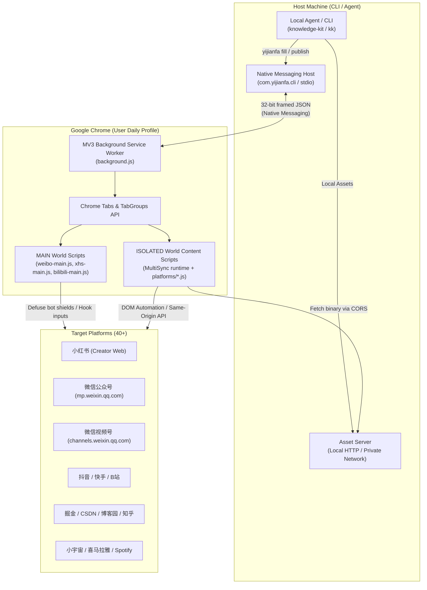

# 一键发 (Yijianfa) Chrome Extension Source Code Review & Knowledge-Kit Enhancement Architecture

## 1. Executive Summary & Overview

The downloaded and unpacked extension **一键发 (v0.1.55, ID: `dmcejnbkknlkpcbaggoeiminccbpliaj`)** is a production-grade multi-platform publishing automation system supporting **40+ platforms** across 5 distinct media domains (`dynamic`, `imageText`, `article`, `shortVideo`, `podcast`).

Unlike typical headless browser scripts, **一键发 operates directly inside the creator's daily Chrome browser via an MV3 Extension + Native Messaging Bridge (`@yijianfa/cli`)**. This delivers three massive advantages over traditional Playwright/Puppeteer automation:
1. **Zero Cookie Drift / No QR Scans**: Completely leverages the user's already-logged-in active session, tokens, and storage state.
2. **Zero Headless Anti-Bot Penalties**: Real browser environment, genuine hardware WebGL fingerprints, authentic TLS/JA3/JA4 fingerprints, and residential IP.
3. **Dual-World Anti-Detection & DOM Shielding**: Injects `MAIN` world hooks at `document_start` to neutralize anti-bot telemetry (e.g. Xiaohongshu's `/shield/webprofile`), while using `ISOLATED` world scripts for reliable form population.

---

## 2. Deep Dive: Core Architecture & Components



### 2.1 Native Messaging Bridge & Ephemeral Asset Server
In `downloads/yijianfa-cli-v0.3.8.tgz`:
- **Protocol**: Standard Chrome Native Messaging over standard I/O (32-bit little-endian length prefix + JSON payload).
- **Socket / Pipe**: Bridges to a Unix domain socket (`~/.yijianfa/run/bridges/`) on macOS/Linux or Named Pipe on Windows.
- **Ephemeral Local Asset Server (`asset-server.js`)**: Starts a local Node.js HTTP server on `127.0.0.1` with CORS and `Access-Control-Allow-Private-Network: true`. When publishing large media files (video/audio/covers) from disk, it passes tokenized localhost URLs (`/v1/assets/:token/:idx/:filename`). Content scripts fetch these blobs directly into memory without reading local files via restricted browser APIs.
- **`fill` vs `publish` Dual Modes**:
  - `fill`: Populates forms, handles file uploads, sets tags/titles/dates, and **leaves the browser tab open for human inspection**.
  - `publish`: Same as `fill`, but clicks publish and executes rigorous postcondition verification before exiting.

### 2.2 Dual-World Injection (`MAIN` vs `ISOLATED`)
A standout engineering achievement in 一键发 is splitting responsibilities across Chrome's execution worlds:

1. **Anti-Bot Shield Neutralization (`platforms/xiaohongshu-main.js`)**:
   - Runs in `world: "MAIN"`, `run_at: "document_start"`.
   - Intercepts `window.fetch`, `XMLHttpRequest.prototype.open/send`, and `navigator.sendBeacon`.
   - Traps requests matching `/shield/webprofile` (Xiaohongshu's risk-control telemetry endpoint) and synthesizes clean responses `{ code: 0, success: true, msg: "ok", data: { st: Date.now() } }`.
   - Implements `makeNativeLike(fn, name)` rewriting `fn.toString()` to return `function name() { [native code] }` and masking `toString.toString()`, bypassing integrity/tampering audits.

2. **OS File Chooser Suppression (`platforms/weibo-main.js`, `bilibili-main.js`)**:
   - Web automation often gets stuck when websites click `<input type="file">`, triggering the native OS file selection modal.
   - In `weibo-main.js`, it hooks `document.createElement`:
     ```javascript
     const originalClick = el.click.bind(el);
     el.click = () => {
       if (isVideoFileInput && pendingFiles?.length > 0) {
         const dt = new DataTransfer();
         for (const file of pendingFiles) dt.items.add(file);
         el.files = dt.files;
         el.dispatchEvent(new Event("change", { bubbles: true }));
         pendingFiles = null;
         return; // SUPPRESSES native file dialog!
       }
       originalClick();
     };
     ```
   - In `bilibili-main.js`, it tracks all dynamically created inputs in the page, attaches files via `DataTransfer`, temporarily disables the input during the button click to avoid dialog popups, and triggers the `change` event.

### 2.3 Same-Origin API vs DOM Hybridization
Unlike naive scraping, 一键发 chooses the most robust approach per platform:

1. **WeChat Official Account (`platforms/weixin.js`) — Same-Origin API (Zero-DOM)**:
   - Scans `document.documentElement.outerHTML` or `location.search` for `token`, `ticket`, `uin`, `user_name`.
   - **Cover upload**: `POST /cgi-bin/filetransfer?action=upload_material` (scene=8).
   - **Auto-crop**: `POST /cgi-bin/cropimage?action=crop_multi` for 2.35:1 (head) and 1:1 (feed) crops.
   - **Body Images**: Parses HTML, iterates over ``, calls `POST /cgi-bin/uploadimg2cdn` (WeChat downloads and converts images into its CDN), and replaces the HTML `src` with the WeChat CDN URL.
   - **Link Sanitization**: Replaces `<a href="...">text</a>` with `<span>text</span>` to prevent WeChat article rejection.
   - **Draft Creation**: Calls `POST /cgi-bin/operate_appmsg?t=ajax-response&sub=create&type=77`.
   - This bypasses all fragile ProseMirror / UEditor DOM automation!

2. **WeChat Channels (`platforms/shipinhao.js`) — Micro-Frontend & Shadow DOM**:
   - Handles `<wujie-app>` micro-frontend shadowRoot (`accountRoots()` traverses both `document` and `wujie-app?.shadowRoot`).
   - Automates Ant Design (`ant-checkbox-input`) components, "声明原创" (declare original creation) modal protocols, and cover crop canvas interactions.

3. **Juejin (`platforms/juejin.js`) — Internal API + Simulated Paste**:
   - Queries `https://api.juejin.cn/interact_api/v1/follow/topic_list` and `tag_api/v1/topic/list_by_rec` using `credentials: "include"`.
   - Detects logged-in account metadata via `/user_api/v1/user/get`.
   - Inserts markdown content using `simulatePaste` via synthetic `ClipboardEvent` with `DataTransfer`, preserving undo stacks and editor state.

### 2.4 Strict Content Limits & Deterministic Segmentation
- **`config/platform-content-limits.js`**:
  - Differentiates counting metrics per platform:
    - `utf16_code_units` (JavaScript `.length`)
    - `unicode_code_points` (`Array.from(text).length`)
    - `weighted` (e.g. CJK = 2, ASCII = 1, URLs = fixed 23 characters as per Twitter t.co)
    - `xiaohongshu_title_weighted` (custom XHS weighted rules)
  - Caps per content type (`tagLimits`, `title`, `body`).
- **`lib/thread-content.js` & `lib/ai-segmentation.js`**:
  - Deterministic string boundary splitting: Splits on paragraphs $\rightarrow$ sentences $\rightarrow$ punctuation $\rightarrow$ spaces.
  - URL protection: Protects URL substrings from being split across thread chunks.
  - Invariant preservation: Guarantees that concatenated thread segments strictly equal the original text without drop or mutation.
  - AI Boundaries with Local Veto: AI suggests semantic cut points, but local deterministic rules enforce length limits and safety boundaries.

### 2.5 MultiSync Postcondition Verification
A common failure in publishing automation is declaring success as soon as the "Publish" button is clicked. 一键发 standardizes on a 5-state lifecycle:
- `applied`: Field/action strictly verified via DOM readback or API receipt.
- `unsupported`: Target platform does not support the requested field (e.g., dynamic post titles on X/Weibo).
- `skipped`: Field intentionally omitted by user configuration.
- `failed`: Action failed with observable error message or timeout.
- `unknown`: Click executed, but page failed to produce observable success proof (completion page, public URL, or toast).

---

## 3. Platform Comparison: 一键发 vs Knowledge-Kit

| Platform Category | Platform | 一键发 (Yijianfa) | knowledge-kit (Current) | Recommended Action for knowledge-kit |
| :--- | :--- | :--- | :--- | :--- |
| **Social / Microblog** | **X / Twitter** | `x.js` (Post + Thread + Article) | `x-pub` (API post, browser article) | Enhance `x-pub` with thread auto-splitting & weighted URL counting |
| | **Threads** | `threads.js` (Thread split) | `threads-pub` (API) | Add multi-post thread chaining to `threads-pub` |
| | **Weibo (微博)** | `weibo.js` + `weibo-main.js` | `weibo-pub` (Browser stub / planned) | Port `weibo-main.js` input click hook & tag selector |
| | **Jike (即刻)** | `jike.js` (Dynamic + Topics) | ❌ Missing | **Add `jike-pub`** (high affinity with tech/AI users) |
| | **Zhihu Pins (想法)** | `zhihu.js` (Pin + Answer) | ❌ Missing | **Add `zhihu-pub`** (dynamic ideas + answers) |
| | **Douban (豆瓣)** | `douban.js` (Broadcast) | ❌ Missing | Low priority |
| | **ZSXQ (知识星球)** | `zsxq.js` (Post + Topics) | ❌ Missing | **Add `zsxq-pub`** (creator monetization) |
| **Tech Blogs / Longform** | **WeChat MP (公众号)** | `weixin.js` (Same-origin API) | `wechatmp-pub` (Playwright DOM) | **Refactor `wechatmp-pub`** to use same-origin CGI API |
| | **Juejin (稀土掘金)** | `juejin.js` (Article + Pins) | `juejin-pub` (Playwright DOM) | Enhance `juejin-pub` to support Pins (沸点) & circle selection |
| | **InfoQ (写作社区)** | ❌ Missing | `infoq-pub` (Playwright ProseMirror) | Keep knowledge-kit's `infoq-pub` (unique advantage!) |
| | **CSDN** | `csdn.js` (Article) | ❌ Missing | **Add `csdn-pub`** (major domestic tech reach) |
| | **Cnblogs (博客园)** | `cnblogs.js` (MetaWeblog / DOM) | ❌ Missing | **Add `cnblogs-pub`** (very developer friendly) |
| | **SegmentFault (思否)**| `segmentfault.js` (Markdown) | ❌ Missing | **Add `segmentfault-pub`** |
| | **51CTO** | `cto51.js` (Article) | ❌ Missing | **Add `cto51-pub`** |
| | **Zhihu Zhuanlan (专栏)**| `zhihuzhuanlan.js` | ❌ Missing | Combine into `zhihu-pub` |
| | **SSPAI (少数派)** | `sspai.js` (Matrix) | ❌ Missing | **Add `sspai-pub`** (high quality tech lifestyle) |
| | **Aliyun / TencentYun** | `aliyun.js`, `tencentyun.js` | ❌ Missing | Consider enterprise/cloud developer community plugins |
| | **Substack / Medium** | `substack.js`, `medium.js` | `substack-pub`, `medium-pub` | Knowledge-kit already has strong API/browser support |
| **Visual / Graphic** | **Xiaohongshu (小红书)** | `xiaohongshu.js` + `xhs-main.js`| `xhs-pub` (Playwright DOM) | **Adopt XHS Shield bypass** (`/shield/webprofile` hook) |
| | **Instagram / Pinterest** | `instagram.js`, `pinterest.js`| ❌ Missing | Candidate for visual fanout |
| **Short Video / Video** | **WeChat Channels (视频号)**| `shipinhao.js` (Wujie ShadowRoot) | ❌ Missing | **Add `shipinhao-pub`** (huge domestic enterprise reach) |
| | **Bilibili (B站)** | `bilibili.js` + `bilibili-main.js`| ❌ Missing | **Add `bilibili-pub`** (video + dynamic) |
| | **Douyin (抖音)** | `douyin.js` (Video + ImageText) | ❌ Missing | **Add `douyin-pub`** |
| | **Kuaishou (快手)** | `kuaishou.js` (Video + ImageText) | ❌ Missing | **Add `kuaishou-pub`** |
| | **YouTube / TikTok** | `youtube.js`, `tiktok.js` | ❌ Missing | Candidate for international video fanout |
| **Audio / Podcast** | **Xiaoyuzhou (小宇宙)** | `xiaoyuzhou.js` (Audio + Shownotes)| ❌ Missing (`podcast-pub` is generic) | **Add `xiaoyuzhou-pub`** (top CN podcast platform) |
| | **Ximalaya (喜马拉雅)** | `ximalaya.js` | ❌ Missing | **Add `ximalaya-pub`** |
| | **QQMusic / NetEase / Spotify**| `qqmusic.js`, `netease.js`, `spotify.js`| ❌ Missing | Specialized podcast distribution |

---

## 4. Key Architectural Lessons & Actionable Recommendations

### Recommendation 1: Enhance `publish-harness` with a Dual-Transport Bridge (`NativeBrowserBridge`)
Currently, `knowledge-kit` relies entirely on headless Playwright sessions (`@gobing-ai/publish-harness/browser`). While great for unattended CI/CD, it suffers from:
- Need to keep cookies fresh in isolated directories (`~/.config/kk/profiles/*`).
- Anti-bot challenges on aggressive platforms (Xiaohongshu, Bilibili, Douyin, WeChat).

**Action**:
Create a companion transport in `@gobing-ai/publish-harness`:
- Transport mode: `'browser-native'` (via Chrome Native Messaging to active Chrome).
- When a user has Chrome open with an installed extension or companion host, `kk publish --transport browser-native` routes commands to the live browser.
- Fallback: When run headlessly in CI or terminal, fallback to Playwright `'browser-script'`.

### Recommendation 2: Adopt the `MAIN` World Anti-Detection Interceptors
In `@gobing-ai/ts-browser-automation` / Playwright flows:
- Use `page.addInitScript()` to inject the same anti-fingerprint and file dialog hooks:
  1. **Xiaohongshu Shield Interceptor**: Hook `fetch`, `XHR`, `sendBeacon` to stub out `/shield/webprofile` and disguise `fn.toString()`.
  2. **File Chooser Supression**: Intercept `input.click()` on file inputs, using `DataTransfer` injection directly to avoid system modals hanging Playwright workers.

### Recommendation 3: Refactor `wechatmp-pub` from Brittle DOM to Same-Origin CGI Calls
Knowledge-kit's `wechatmp-pub` currently automates the WeChat MP backend DOM editor via Playwright.
**Learning from `weixin.js`**:
Once the page is opened and logged in, execute in-page `fetch`:
1. Extract `token` and `ticket` from URL and DOM HTML.
2. Upload cover via `/cgi-bin/filetransfer?action=upload_material`.
3. Auto-crop cover via `/cgi-bin/cropimage?action=crop_multi`.
4. Upload all body images via `/cgi-bin/uploadimg2cdn`.
5. Create draft via `/cgi-bin/operate_appmsg?t=ajax-response&sub=create&type=77`.
This reduces execution time from ~45 seconds of flaky UI clicking to **< 3 seconds of deterministic API calls**.

### Recommendation 4: Introduce `platform-content-limits` Core Library in `@gobing-ai/kk-core`
Extract the rules from `platform-content-limits.js`, `thread-content.js`, and `ai-segmentation.js` into a shared package `@gobing-ai/content-rules`:
- Exact character weighting formulas (CJK weighted vs Unicode code points vs UTF-16 code units).
- Twitter 23-char URL weighting and thread auto-split algorithms.
- Title and tag count validators before handing off to publish plugins.

### Recommendation 5: Prioritized Roadmap for New Publish Plugins
Based on platform reach and engineering feasibility, add the following plugins to `plugins/publishings/`:

1. **Tier 1 (High Value / Direct Synergy with Existing Pipeline)**:
   - `jike-pub` (即刻): Microblogging/ideas, high concentration of tech/AI audience. Uses simple JSON API / DOM.
   - `csdn-pub` & `cnblogs-pub`: High SEO developer authority in China, straightforward Markdown editors.
   - `shipinhao-pub` (微信视频号): Crucial for short video / omni-voice distribution to WeChat ecosystem.
   - `xiaoyuzhou-pub` (小宇宙): Directly complements knowledge-kit's `omni-voice-gen` / `podcast-pub` pipelines for audio creators.

2. **Tier 2 (Rich Media & Video Expansion)**:
   - `bilibili-pub` (B站): Dynamic posts + Video uploads with cover selection.
   - `douyin-pub` (抖音): Short video + Image-text notes.
   - `sspai-pub` (少数派): Premium tech community.
   - `zsxq-pub` (知识星球): Community updates and paid creator circles.

3. **Tier 3 (Broader Aggregation)**:
   - `segmentfault-pub` (思否), `cto51-pub` (51CTO), `toutiao-pub` (头条号), `baijiahao-pub` (百家号).
