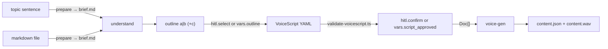
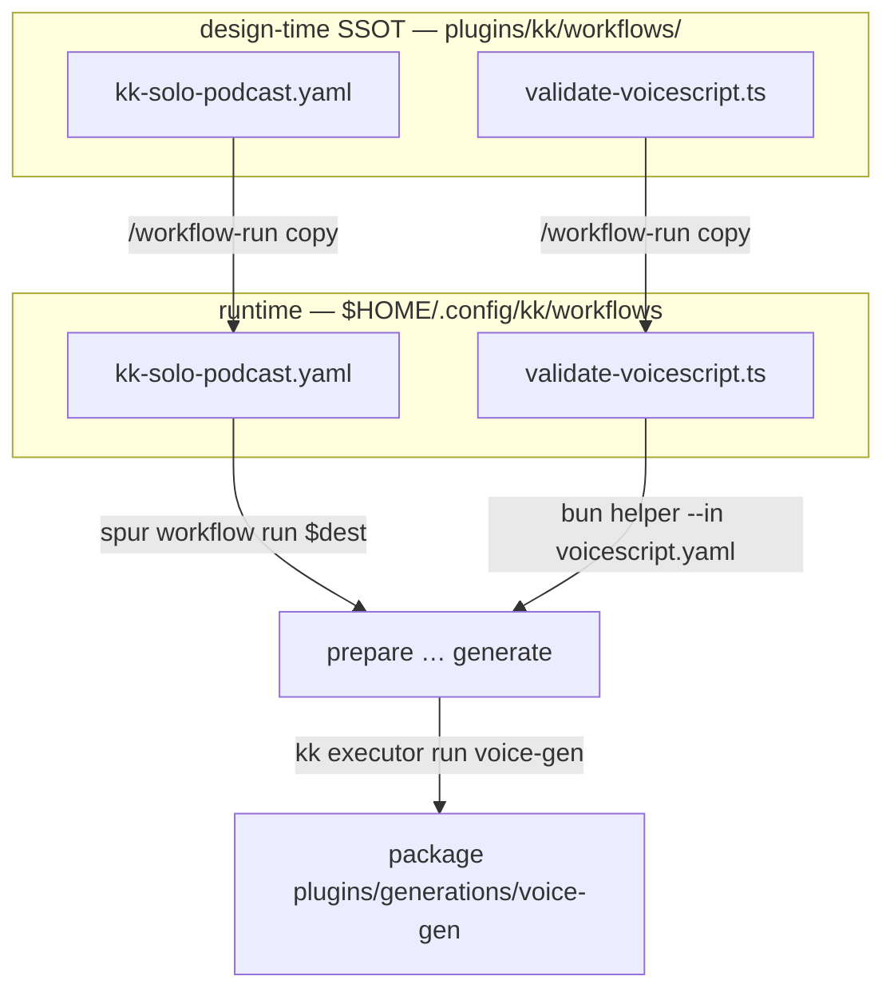

# Solo-Podcast Workflow (`kk-solo-podcast`)

Turn one text source — a **sentence XOR a markdown file** — plus a target spoken length into a
solo podcast: briefing → outline HITL → VoiceScript → `voice-gen` → sibling **WAV**. The
machine is `prepare → understand → outline-write → (outline-select) → outline-commit →
script-write → script-validate → (script-review) → wrap-docs → generate → duration-check`
(no publish).

Two homes (do not mix them up):

| Role | Path |
| --- | --- |
| **Design-time SSOT** | package/repo `plugins/kk/workflows/` (source of the copy) |
| **Runtime dest** | `$KK_WORKFLOWS_DIR` (default `$HOME/.config/kk/workflows`) |

**Always run the copy under `$HOME/.config/kk/workflows`.** The YAML, the VoiceScript checker
(`validate-voicescript.ts`), and `spur workflow run` refer to that directory. Checkout
`docs/design/` is **not** on the runtime path and is not in the npm tarball — the `agent.run`
prompt carries the VoiceScript contract inline.



Audio format is **WAV** (D5 sibling of `--out`). Voicebox does **not** take a target duration;
length is a **word/char budget** at script-write plus a post-generate check on
`metadata.duration`.

| Piece | Design-time (tarball / repo) | Runtime |
| --- | --- | --- |
| Workflow YAML | `plugins/kk/workflows/kk-solo-podcast.yaml` | `$HOME/.config/kk/workflows/kk-solo-podcast.yaml` |
| Validator | `plugins/kk/workflows/validate-voicescript.ts` | `$HOME/.config/kk/workflows/validate-voicescript.ts` |
| Wrapper | `plugins/kk/workflows/wrap-voicescript-doc.ts` | `$HOME/.config/kk/workflows/wrap-voicescript-doc.ts` |
| Generator | `plugins/generations/voice-gen/` (npm pack) | `kk executor run voice-gen` (ADR-012 discovery) |

## Prerequisites

- **`kk` on PATH** (`kk executor run`). After `npm i -g @gobing-ai/knowledge-kit`, plugin
  discovery finds `voice-gen` without `--plugins-path`. From a checkout only:

  ```bash
  bun run build
  cd apps/cli && bun link
  kk plugin status --kind generator --plugins-path ./plugins --json
  ```

- **Live generate** needs Voicebox at `VOICEBOX_URL` (default `http://127.0.0.1:17493`) and a
  resolvable profile: `voice_profile` in `--vars` **or** `VOICEBOX_DEFAULT_PROFILE`. Missing both
  → `prepare` exits 1, `missing voice_profile (set vars.voice_profile or VOICEBOX_DEFAULT_PROFILE)`.
- **Outline / script authoring** needs `spur agent doctor <agent>`. `--dry-run` is the only fully
  offline walk.

## Daily run — `/workflow-run kk-solo-podcast`

Preferred operator surface. First run creates `~/.config/kk/config.yaml` if missing, **copies**
`kk-solo-podcast.yaml` **and its sidecars** (`validate-voicescript.ts`, `wrap-voicescript-doc.ts`) into
`$HOME/.config/kk/workflows/`,
computes `work_dir` under `$works_dir/<kebab>`, and shells `spur workflow run "$dest"` where
`$dest` is that runtime YAML.

```text
/workflow-run kk-solo-podcast <topic|--in file> [--dir <path>] [--outline a|b|c]
             [--duration <min>] [--language <code>] [--script-approved] [--force]
```

| Token | Meaning | Default |
| --- | --- | --- |
| `<topic>` | episode brief sentence | required unless `--in` |
| `--in <file>` | markdown file mode (XOR with `<topic>`) | — |
| `--dir <path>` | episode workspace | `$works_dir/<kebab>` |
| `--outline a\|b\|c` | skip outline HITL | HITL |
| `--duration <min>` | `target_duration_min` | `8` |
| `--language <code>` | Voicebox language | `en` |
| `--script-approved` | skip script HITL (`script_approved=true`) | off |
| `--force` | overwrite dest YAML / sidecar / existing `brief.md` | off |

`--fixture` with this profile → exit 1 (`fixture is storm-only`).

XOR: exactly one of `<topic>` / `--in`. Both or neither → exit 1, no writes.

## Checkout / CI — still run the **runtime** dest

After a copy (or `/workflow-run` once), validate and dry-run the file under
`$HOME/.config/kk/workflows`, not `plugins/kk/workflows/`.

### Validate

```bash
spur workflow validate "$HOME/.config/kk/workflows/kk-solo-podcast.yaml" --json
```

Design-time check of the SSOT (CI against the repo) may still validate
`plugins/kk/workflows/kk-solo-podcast.yaml`. Operators do not.

### Dry-run — no Voicebox, no LLM, no writes

`--dry-run` does not execute actions, but `pause: true` still pauses. Skip both HITL states:

```bash
spur workflow run "$HOME/.config/kk/workflows/kk-solo-podcast.yaml" --dry-run --run-id dry-solo \
  --vars '{"topic":"Why HNSW search degrades at 1B rows","work_dir":"./scratch/solo-dry","outline":"a","script_approved":"true","target_duration_min":"8","voice_profile":"Robin","language":"en","force":"true"}'
```

`validate_script` empty → `${KK_WORKFLOWS_DIR:-$HOME/.config/kk/workflows}/validate-voicescript.ts`.
`plugins_path` empty → ADR-012 default discovery (no checkout `./plugins`).

Expect `status: done` (9 transitions). Missing `4-audio/content.json` makes `duration-check`
succeed (dry-run passes). Do not switch success edges to `action-ok`.

### Real run — sentence

```bash
spur workflow run "$HOME/.config/kk/workflows/kk-solo-podcast.yaml" \
  --vars '{"topic":"Why HNSW search degrades at 1B rows","work_dir":"$HOME/.config/kk/works/solo-hnsw","target_duration_min":"8","voice_profile":"Robin","language":"en"}'
```

Pauses at `hitl.select` (outline) then `hitl.confirm` (script) before TTS. Rejecting the script
opens `hitl.input` (cap 3, then `failed`).

### Real run — file (XOR)

```bash
spur workflow run "$HOME/.config/kk/workflows/kk-solo-podcast.yaml" \
  --vars '{"input_file":"./notes/episode-brief.md","work_dir":"$HOME/.config/kk/works/solo-file","target_duration_min":"8","voice_profile":"Robin"}'
```

Existing `${work_dir}/brief.md` without `"force":"true"` → exit 1.

Monitor: `spur workflow trace <run-id> --json`.

## What each state writes

| State | Action | Writes |
| --- | --- | --- |
| `prepare` | `mkdir`; XOR; profile; `brief.md` | `${work_dir}/brief.md` + four subdirs |
| `understand` | `agent.run` scribe | `1-briefing/briefing.md` |
| `outline-write` | `agent.run`; require `-b.md` | `2-outline/outline-option-{a,b}.md` (+ optional c) |
| `outline-select` | `hitl.select` (skip when `outline` set) | — |
| `outline-commit` | `cp` | `2-outline/outline-approved.md` |
| `script-write` | `agent.run`; inlined VoiceScript contract | `3-script/voicescript.yaml` |
| `script-validate` | `bun $HOME/.config/kk/workflows/validate-voicescript.ts --in …` | — |
| `script-review` | `hitl.confirm` (skip when `script_approved=true`) | — |
| `script-revise` | `hitl.input`; cap 3 | `${work_dir}/.revise-count` |
| `wrap-docs` | `bun …/wrap-voicescript-doc.ts` | `4-audio/docs.json` |
| `generate` | `kk executor run voice-gen` | `4-audio/content.json` + `content.wav` |
| `duration-check` | band check `onEnter`; miss → feedback + retry | `.duration-ok` on pass; `.duration-feedback` + `.revise-count++` on miss |

## Duration policy

Voicebox records duration; it does not accept a length flag.

| Language | Budget | Formula |
| --- | --- | --- |
| `zh` / `ja` / `ko` | `cjk_chars_per_min` (default `"220"`) | `target_chars = target_duration_min * cjk_chars_per_min` |
| else | `words_per_min` (default `"150"`) | `target_words = target_duration_min * words_per_min` |

Post-generate: `duration-check` reads `metadata.duration`; missing/non-numeric or outside
`[0.5, 2] × target_duration_min * 60` → writes `work_dir/.duration-feedback`, increments the
shared `work_dir/.revise-count` (cap 3), and routes back to `script-write`; budget exhausted →
`failed`.

## Env

| Variable | Required | Default | Role |
| --- | --- | --- | --- |
| `KK_WORKFLOWS_DIR` | no | `$HOME/.config/kk/workflows` | runtime YAML + helper dest |
| `KK_WORKS_DIR` | no | `$HOME/.config/kk/works` | default episode parent |
| `KK_CONFIG` | no | `$HOME/.config/kk/config.yaml` | config file |
| `VOICEBOX_URL` | no | `http://127.0.0.1:17493` | Voicebox origin |
| `VOICEBOX_DEFAULT_PROFILE` | if `voice_profile` empty | — | profile name/id |
| `VOICEBOX_TIMEOUT_MS` | no | `600000` | per-generation poll |
| `VOICEBOX_POLL_MS` | no | `1000` | poll interval |
| `VOICEBOX_MAX_CHUNK_CHARS` | no | `800` | chunk (100–5000) |
| `VOICEBOX_CROSSFADE_MS` | no | `50` | crossfade (0–500) |

## Workflow vars (all strings)

| Var | Default | Role |
| --- | --- | --- |
| `topic` / `input_file` | `""` | XOR source |
| `work_dir` | required | resolved episode dir |
| `force` | `"false"` | overwrite `brief.md` |
| `outline` | `""` | pre-select `a`/`b`/`c` |
| `script_approved` | `""` | `"true"` skips script HITL |
| `target_duration_min` | `"8"` | minutes |
| `words_per_min` / `cjk_chars_per_min` | `"150"` / `"220"` | spoken budget |
| `voice_profile` | `""` | else `VOICEBOX_DEFAULT_PROFILE` |
| `language` | `"en"` | Voicebox language |
| `plugins_path` | `""` | empty → ADR-012 defaults; checkout may set `./plugins` |
| `validate_script` | `""` | empty → `$KK_WORKFLOWS_DIR/validate-voicescript.ts` |
| `agent` | `""` | `agent.run` |
| `wrap_script` | `""` | empty → `$KK_WORKFLOWS_DIR/wrap-voicescript-doc.ts` |

## Using `voice-gen` / the checker directly

```bash
kk executor run voice-gen --in docs.json --out content.json
bun "${KK_WORKFLOWS_DIR:-$HOME/.config/kk/workflows}/validate-voicescript.ts" --in ./voicescript.yaml
```

`--in` to `voice-gen` is `Doc[]`. `Doc.body` is plain text or VoiceScript YAML/JSON. WAV is
`${dirname(out)}/${basename(out, ext)}.wav`.

## Limitations

- **No MP3** — Voicebox returns WAV.
- **Duration is approximate** — WPM/CPM budget, then 0.5×–2× check.
- **Solo only** — one speaker via `default_profile`.
- **No publish / judge.** No `kk workflow` noun (ADR-011).
- **Live TTS is not CI** — static tests + validate + `--dry-run`.
- **Do not `agent.run` `docs/design/*`** — not in the tarball; contract is inlined.

## Under the hood



### File inventory

| File | Role |
| --- | --- |
| `plugins/kk/workflows/kk-solo-podcast.yaml` | design-time SSOT (copied to runtime dest) |
| `plugins/kk/workflows/validate-voicescript.ts` | design-time checker (copied beside the YAML) |
| `plugins/kk/workflows/wrap-voicescript-doc.ts` | VoiceScript → `Doc[]` wrapper (copied beside the YAML) |
| `plugins/generations/voice-gen/` | D5 generator in the npm tarball |
| `docs/design/kk-solo-podcast.md` | maintainer satellite (not loaded at runtime) |

### Workflow notes

- **XOR prepare.** Both or neither of `topic` / `input_file` → exit 1.
- **Success edges `always`** except named shell skips. Quote `"$schema"`.
- **Checker is builtins-only** (no `@gobing-ai/*`). SYNC comment points at
  `plugins/generations/voice-gen/src/voicescript.ts`.

## Testing & verification

```bash
spur workflow validate plugins/kk/workflows/kk-solo-podcast.yaml --json
spur workflow run "$HOME/.config/kk/workflows/kk-solo-podcast.yaml" --dry-run --run-id dry-solo \
  --vars '{"topic":"duration budget smoke","work_dir":"./scratch/solo-dry","outline":"a","script_approved":"true","target_duration_min":"8","voice_profile":"Robin","force":"true"}' --json
bun test apps/cli/tests/kk-solo-podcast-workflow.test.ts \
  apps/cli/tests/validate-voicescript.test.ts \
  apps/cli/tests/workflow-run-command.test.ts
```

After any change: `bun run lint && bun run test && bun run build`.

## Out of this workflow

- MP3 / ffmpeg; a duration flag on `voice-gen`.
- A fat `solo-podcast` skill; a `kk` first-layer noun.
- Multi-host interview; audio publish; live Voicebox in CI.
- Loading `docs/design/*` from `agent.run`.
