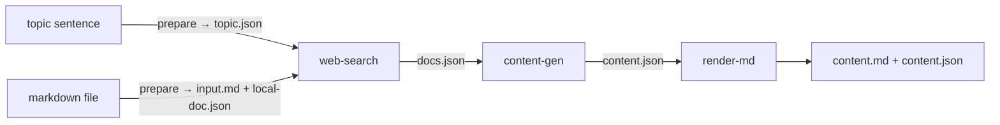
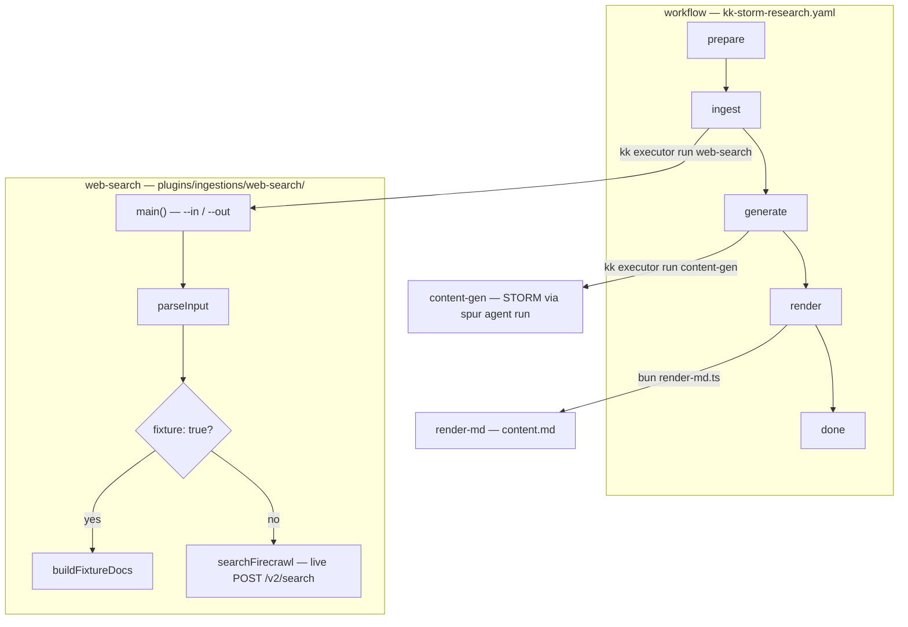

# STORM Topic-Research Workflow (`kk-storm-research`)

Turn one research topic — a **sentence XOR a markdown file** — into a grounded STORM `Content`
report plus a human-readable `content.md` sidecar. The machine is
`prepare → ingest → generate → render` (no publish, no judge).

This is the C4 daily-usable path. Daily invoke is the `/workflow-run` slash command (skill
`storm-research`). A checkout can also call `spur workflow run` directly.



Default ingest is **live Firecrawl** (`fixture: "false"`). Pass `--fixture` / `fixture: "true"`
for the offline stub. Generation always uses a live `spur agent run` — fixture does **not**
stub `content-gen`.

| Piece | Path |
| --- | --- |
| Repo SSOT | `plugins/kk/workflows/kk-storm-research.yaml` |
| Ingest plugin | `plugins/ingestions/web-search/` |
| Render runner | `plugins/kk/scripts/render-md.ts` (resolved and run by `plugins/kk/scripts/kk-workflow-stages.ts`) |
| Skill / command | `plugins/kk/skills/storm-research/` · `plugins/kk/commands/workflow-run.md` |
| Ingest contract | `docs/tasks/0054_specify-the-firecrawl-topic-to-doc-ingest-contract.md` |
| Works / XOR / install | `docs/tasks/0056_specify-the-kk-config-works-workspace-and-workflow-install-c.md` |

## Prerequisites

- **`kk` on PATH** with the `executor` verb (`kk executor run`). From this repo:

  ```bash
  bun run build
  cd apps/cli && bun link
  kk plugin status --kind ingestion --plugins-path ./plugins --json
  ```

  That listing must include `web-search`.

- **Live ingest** needs `FIRECRAWL_API_KEY` in the environment (never in config or `--vars`).
  Missing key on a live run: exit 1, stderr `web-search failed: FIRECRAWL_API_KEY is unset`.
- **Real generate** needs a working spur agent (`spur agent doctor <agent>`). `content-gen`
  shells four `spur agent run` stages. There is no offline generate stub.

## Daily run — `/workflow-run`

Preferred operator surface. First run creates `~/.config/kk/config.yaml` if missing (never
overwrites an existing file), resolves the workflow YAML **in place** (user override →
`KK_WORKFLOWS_SOURCE` → bun/npm global installs → installed package root → repo checkout —
no copy), computes `topic-id`, and shells `spur workflow run`.

```text
/workflow-run [name] <topic|--in file> [--fixture] [--force]
```

| Token | Meaning | Default |
| --- | --- | --- |
| `name` | installed workflow file stem | `kk-storm-research` |
| `<topic>` | research question (prefer a question, not a noun phrase) | required unless `--in` |
| `--in <file>` | markdown file mode (XOR with `<topic>`) | — |
| `--fixture` | force ingest stub (`fixture: "true"`) | config default (`false`) |
| `--force` | overwrite an existing dest YAML | off |

Examples:

```text
/workflow-run "What are the known failure modes of vector databases at 1B rows?"
/workflow-run --in ./notes/hnsw-brief.md
/workflow-run kk-storm-research --in ./notes/hnsw-brief.md --fixture
```

XOR: exactly one of `<topic>` / `--in`. Both or neither → exit 1, no writes.

Craft (how to get a better report) lives in `plugins/kk/skills/storm-research/SKILL.md` —
query framing, when to re-run ingest vs reuse `docs.json`, and checking `content.md`
citations against `docs.json` ids. Do not merge this into `topic` (authoring only).

## Checkout / CI — `spur workflow run`

### Validate

```bash
spur workflow validate plugins/kk/workflows/kk-storm-research.yaml --json
```

### Dry-run — no network, no LLM, no writes

```bash
spur workflow run plugins/kk/workflows/kk-storm-research.yaml --dry-run --run-id dry-1 \
  --vars '{"topic":"<your research topic>","fixture":"true"}'
```

Expect `status: done` (4 transitions: `prepare → ingest → generate → render`). Success
edges use `guard: { kind: always }` so dry-run can walk to `done` — do not switch them
to `action-ok` (that guard denies when no actions execute).

### Real run — sentence

`work_dir` must be the **resolved** topic directory. The slash command computes it; from
a checkout you pass it yourself:

```bash
spur workflow run plugins/kk/workflows/kk-storm-research.yaml \
  --vars '{"topic":"<your research topic>","maxResults":"8","work_dir":"./work/demo-topic"}'
```

Live ingest (default) needs `FIRECRAWL_API_KEY`. For the stub:

```bash
--vars '{"topic":"<topic>","fixture":"true","work_dir":"./work/demo-topic"}'
```

### Real run — file (XOR)

File mode copies the file to `input.md`, writes `local-doc.json` (one Doc object; generate
wraps it before prepend), and derives the query from the first ATX H1, else the basename.

```bash
spur workflow run plugins/kk/workflows/kk-storm-research.yaml \
  --vars '{"input_file":"./note.md","fixture":"true","work_dir":"./work/demo-topic"}'
```

Monitor: `spur workflow trace <run-id> --json`.

## What each state writes

| State | Action | Writes |
| --- | --- | --- |
| `prepare` | stage runner (`prepare-storm`): `mkdir`; XOR guard; sentence → `topic.json`; file → `input.md` + `local-doc.json` + `topic.json` | `${work_dir}/topic.json` (+ `input.md`, `local-doc.json` in file mode) |
| `ingest` | `kk executor run web-search --in topic.json --out docs.json` | `${work_dir}/docs.json` |
| `generate` | if `local-doc.json` exists, `jq -s '[.[0]] + .[1]'` onto `docs.json`; then `kk executor run content-gen` | `${work_dir}/content.json` |
| `render` | stage runner (`render-storm`) → `bun render-md.ts --in content.json --out content.md` | `${work_dir}/content.md` |

Same `raw` (topic string, or file H1 / basename) maps to the same `topic-id` workspace.
Last write wins. Sentence-mode `prepare` does **not** delete a leftover `local-doc.json`
from an earlier file-mode run in that directory — use a new topic or remove the file.

## Config, env, and topic-id

Config file: `${KK_CONFIG:-$HOME/.config/kk/config.yaml}`.

```yaml
works_dir: "$HOME/.config/kk/works"
workflows_dir: "$HOME/.config/kk/workflows"
defaults:
  maxResults: 8
  fixture: false
```

| Value | Env | Default |
| --- | --- | --- |
| config path | `KK_CONFIG` | `~/.config/kk/config.yaml` |
| `works_dir` | `KK_WORKS_DIR` | `~/.config/kk/works` |
| `workflows_dir` | `KK_WORKFLOWS_DIR` | `~/.config/kk/workflows` |
| YAML search extra | `KK_WORKFLOWS_SOURCE` | — |
| Firecrawl secret | `FIRECRAWL_API_KEY` | unset (live ingest fails loud) |

Precedence: command flag > env > file > compiled default. Secrets never go in the YAML
or `config.yaml`.

`topicId(raw)` (computed by `/workflow-run`, not by the workflow YAML):

1. normalize = trim, collapse whitespace, lowercase
2. slug = `[^a-z0-9]+` → `-`, squeeze, trim, slice 48; empty → `topic`
3. hash = `sha256(normalized).hex[0:8]`
4. id = `slug-hash` → `work_dir = $works_dir/kk-storm-research/<id>`

Existing `.works/`-era trees (flat `$works_dir/<id>` dirs) are **not** migrated; pass
`--dir` to rerun against one.

## Workflow vars (all strings)

`spur workflow --vars` rejects non-string values. `maxResults` is coerced with
`($maxResults | tonumber)`. `fixture` is true only when the string equals `"true"`.

| Var | Default | Role |
| --- | --- | --- |
| `topic` | `""` | sentence-mode query; ignored when `input_file` set |
| `input_file` | `""` | file-mode path when non-empty (XOR) |
| `maxResults` | `"8"` | ingest cap (int in `topic.json`) |
| `fixture` | `"false"` | `"true"` = web-search stub; CI/dry-run should pass this |
| `work_dir` | `"./work"` | **resolved** topic dir — invoker sets `$works_dir/kk-storm-research/<topic-id>` (`--dir` overrides) |
| `plugins_path` | `"./plugins"` | `--plugins-path` for `kk executor run` |
| `ingestion_plugin` | `"web-search"` | |
| `generator_plugin` | `"content-gen"` | |
| `render_script` | `"plugins/kk/scripts/render-md.ts"` | |

## Using `web-search` directly

```bash
kk executor run web-search --in in.json --out docs.json --plugins-path ./plugins
```

`--in` JSON (0054): `topic` required (non-empty string); `maxResults` optional positive int
(default 8); `fixture` optional boolean.

| `fixture` | Behavior |
| --- | --- |
| `true` | canned `Doc[]` (stable `sha256(sourceUri)` 16-hex ids). No network, no key. |
| absent / `false` | live `POST https://api.firecrawl.dev/v2/search` + `scrapeOptions.formats: ["markdown"]`. Requires `FIRECRAWL_API_KEY`. |

Fail-loud (live): missing key → exit 1, no `--out`; HTTP 401/429/5xx → exit 1, no retry;
zero hits → `[]` + exit 0; hits but no usable markdown → exit 1.

## Limitations

- **No query expansion** — the topic (or derived file query) is the single Firecrawl `query`.
- **Generate is always live-LLM** — `fixture: true` only stubs ingest. A fixture run still
  needs `spur agent run` to finish `generate` / `render`. `--dry-run` is the only fully
  offline walk of the machine.
- **No publish / judge** — terminates at `content.md`. Out of C4 by design.
- **No `kk workflow` CLI noun** — ADR-011. Daily invoke is the slash command + skill, or
  raw `spur workflow run`.
- **Resume is last-write-wins** — leftover `local-doc.json` can change a later sentence-mode
  run in the same works dir.

## Under the hood (maintainer guide)



### File inventory

| File | Role |
| --- | --- |
| `plugins/kk/workflows/kk-storm-research.yaml` | orchestration SSOT |
| `plugins/kk/scripts/kk-workflow-stages.ts` | stage runner: `prepare-storm` (topic/local-doc derivation) + `render-storm` (ADR-115 owner, shared with kk-itc / kk-solo-podcast) |
| `plugins/ingestions/web-search/src/index.ts` | fixture + live Firecrawl (`searchFirecrawl`) |
| `plugins/kk/scripts/render-md.ts` | shipped `--in` / `--out` runner (no `@gobing-ai/kk-core` import) |
| `packages/kk-core/src/render-md.ts` | `renderContentMarkdown` (in-repo SSOT; keep in sync) |
| `plugins/kk/skills/storm-research/SKILL.md` | run + better-report craft |
| `plugins/kk/commands/workflow-run.md` | thin slash-command procedure |

### Workflow notes

- **XOR prepare.** Both or neither of `topic` / `input_file` → exit 1, no writes.
- **local-doc merge.** `prepare` writes a **single Doc object**. `generate` wraps it:
  `jq -s '[.[0]] + .[1]'` (do not revert to `.[0] + .[1]` — that is a type error).
- **Success edges `always`.** Dry-run would never reach `done` on `action-ok`. Real-run
  failures still stop at the state (`onError: fail`) before transitions run.
- **Quote `"$schema"`** or YAML parsing mangles it.

## Testing & verification

```bash
spur workflow validate plugins/kk/workflows/kk-storm-research.yaml --json
spur workflow run plugins/kk/workflows/kk-storm-research.yaml --dry-run --run-id dry-1 \
  --vars '{"topic":"STORM topic research","fixture":"true"}' --json
bun test apps/cli/tests/storm-research-workflow.test.ts \
  plugins/ingestions/web-search/tests/web-search.test.ts \
  packages/kk-core/tests/render-md.test.ts \
  apps/cli/tests/workflow-run-command.test.ts
```

After any change: `bun run lint && bun run test && bun run build`.

## Out of this workflow

- Query expansion, `judge` after generate, publish channels.
- A `kk` first-layer `workflow` noun (ADR-011).
- Changing D4 / `content-gen` to retrieve from the web, or adding an offline generate stub.
- Co-STORM / `vendors/storm` at runtime.
