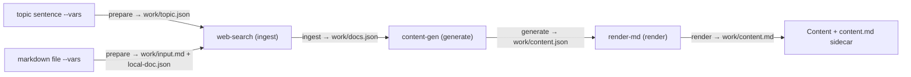
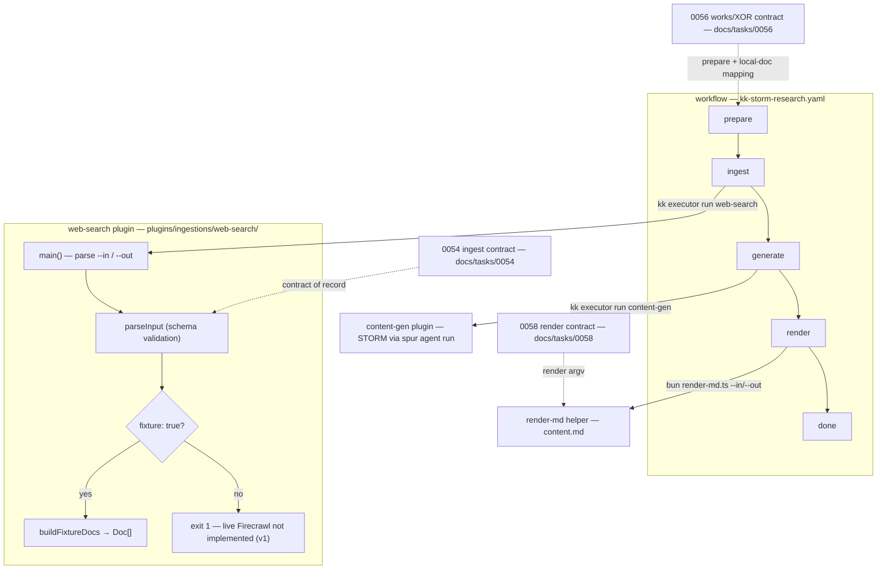

# STORM Topic-Research Workflow (`kk-storm-research`)

Turn one research topic into a grounded STORM `Content` report by composing the `web-search`
ingestion plugin with the `content-gen` generator and the `render-md` helper — no publish step.
This is the C4 daily-usable workflow (feature C4): the machine accepts a topic **sentence XOR a
markdown file**, writes the 0056 works layout, and dry-runs to `done` with a `content.md` sidecar.

The ingest side is a **fixture stub** by default — there is no live Firecrawl client in v1
(0057 is the live client; 0059 keeps `fixture` switchable and does not implement Firecrawl).



Pieces: workflow `.spur/workflows/kk-storm-research.yaml` (install source
`plugins/kk/workflows/kk-storm-research.yaml`) · plugin `plugins/ingestions/web-search/` ·
render helper `plugins/kk/scripts/render-md.ts` · ingest contract
`docs/tasks/0054_specify-the-firecrawl-topic-to-doc-ingest-contract.md`.

## Prerequisites

- Repo checkout with dependencies installed: `bun install`.
- **`kk` on PATH with the `executor` verb** — the workflow shells `kk executor run`. A stale
  globally-installed `kk` (e.g. a pre-`executor` build) will fail at the `ingest`/`generate`
  states. Build and link the repo CLI:

  ```bash
  bun run build                  # builds apps/cli → dist/index.js (bin: kk)
  cd apps/cli && bun link        # makes `kk` resolve to this build
  ```

  Sanity check — this must list `web-search`:

  ```bash
  kk plugin status --kind ingestion --plugins-path ./plugins --json
  ```

- **Real runs (not dry-run) also need the spur agent** — `content-gen`'s STORM pipeline calls
  `spur agent run` for its generation stages. Check with `spur agent doctor <agent>` (the
  configured default; `omp` in this repo).

## Run it

### 1. Validate the workflow

```bash
spur workflow validate .spur/workflows/kk-storm-research.yaml --json
```

### 2. Dry-run — no network, no LLM, no writes to `work/`

```bash
spur workflow run .spur/workflows/kk-storm-research.yaml --dry-run --run-id dry-1 \
  --vars '{"topic":"<your research topic>","fixture":"true"}'
```

Expect `status: done` with terminal state `done` (4 transitions:
`prepare → ingest → generate → render`). Success edges use `guard: { kind: always }`, which is
what lets dry-run walk to `done` — do not switch them to `action-ok` (that guard denies in
dry-run because no actions execute).

Pass `fixture: "true"` for any dry-run / CI / dogfood invocation so the stub is selected; a real
daily run omits it (or passes `"false"`).

### 3. Real run — sentence input

```bash
spur workflow run .spur/workflows/kk-storm-research.yaml \
  --vars '{"topic":"<your research topic>","maxResults":"8","work_dir":"./work/demo-topic"}'
```

### 4. Real run — file input (XOR)

Pass exactly one of `topic` / `input_file`. File mode copies the file to `input.md`, writes the
0056 `local-doc.json` one-element `Doc[]`, and derives the query from the first ATX H1 (else the
basename).

```bash
spur workflow run .spur/workflows/kk-storm-research.yaml \
  --vars '{"input_file":"./note.md","fixture":"true","work_dir":"./work/demo-topic"}'
```

What happens per state:

| State | Action | Writes |
| --- | --- | --- |
| `prepare` | `mkdir work_dir`; XOR guard (exactly one of `topic`/`input_file`); sentence mode materializes `topic.json`; file mode copies `input.md`, writes `local-doc.json`, writes `topic.json` | `${work_dir}/topic.json` (+ `input.md`, `local-doc.json` in file mode) |
| `ingest` | `kk executor run web-search --in topic.json --out docs.json --plugins-path ./plugins` | `${work_dir}/docs.json` |
| `generate` | prepends `local-doc.json` onto `docs.json` when present, then `kk executor run content-gen --in docs.json --out content.json` | `${work_dir}/content.json` (STORM `Content`) |
| `render` | `bun plugins/kk/scripts/render-md.ts --in content.json --out content.md` | `${work_dir}/content.md` (markdown sidecar) |

Monitor a long run: `spur workflow trace <run-id> --json`.

## Workflow vars (all strings)

`work_dir` is the **resolved** topic directory (`$works_root/<topic-id>`), computed by the
invoker (the `/kk-workflow` command, 0060, or the operator) and passed as `--vars`. `prepare`
never hashes the topic-id in YAML.

| Var | Default | Role |
| --- | --- | --- |
| `topic` | `""` | sentence-mode query; ignored when `input_file` set (XOR) |
| `input_file` | `""` | file-mode markdown path when non-empty (XOR) |
| `maxResults` | `"8"` | caps the ingested item count (written into `topic.json` as an int) |
| `fixture` | `"false"` | `"true"` selects the fixture stub; CI/dry-run must pass `"true"` |
| `work_dir` | `"./work"` | resolved topic dir (`$works_root/<topic-id>`) — invoker sets this |
| `plugins_path` | `"./plugins"` | `--plugins-path` for `kk executor run` |
| `ingestion_plugin` | `"web-search"` | executor name |
| `generator_plugin` | `"content-gen"` | executor name |
| `render_script` | `"plugins/kk/scripts/render-md.ts"` | 0058 shipped render runner |

## Using `web-search` directly

```bash
kk executor run web-search --in in.json --out docs.json --plugins-path ./plugins
```

`--in` JSON (0054 contract): `topic` **required** (non-empty string); `maxResults` optional
(positive int, default 8 — caps the emitted list); `fixture` optional (boolean).

v1 stub behavior: `fixture: true` emits canned `Doc[]` (stable `sha256(sourceUri)` 16-hex ids,
markdown bodies — citation-safe for D4). `fixture` absent/false selects the **not-implemented**
live path: exit 1 with `live Firecrawl not implemented in v1 (pass "fixture": true to use the
fixture stub)`, no `--out`. Missing/invalid `topic` → exit 1. No `FIRECRAWL_API_KEY` is used in
v1 (env-only by contract; the live client is task 0057).

## Limitations (v1 scope)

- **No live Firecrawl** — ingest is the fixture stub unless 0057's live client is wired up; the
  future live path (`POST https://api.firecrawl.dev/v2/search` +
  `scrapeOptions.formats: ["markdown"]`) is specified in the 0054 contract.
- **No query expansion** — `topic` (or the derived file query) is sent verbatim as the single query.
- **Generate requires the spur agent** — `content-gen` runs its STORM stages via `spur agent run`.
- **No publish state** — by design; the workflow terminates at `content.md` rendered `done`.
  Publish and the judge gate are out of scope for C4.
- **Config loader / `/kk-workflow` command** — 0060 ships the `kk-storm-research` skill + generic
  workflow command (topic-id computation, config create, YAML install to `$workflows_dir`).
  Until then, the operator passes `work_dir` and `--vars` directly.

## Under the hood (maintainer guide)

The workflow state machine, the `web-search` plugin, and the `render-md` helper compose exactly
three artifacts. The *how ingest must behave* is the 0054 contract (Solution blocks 1–8); *how
the works layout + XOR prepare must behave* is the 0056 contract; *how render must behave* is the
0058 contract. Update the contract first when behavior changes, or note the deliberate departure
in the same change.

The architecture at a glance:



### File inventory

| File | Role |
| --- | --- |
| `.spur/workflows/kk-storm-research.yaml` | the orchestration: `prepare → ingest → generate → render → done/failed` (repo SSOT) |
| `plugins/kk/workflows/kk-storm-research.yaml` | **byte-identical** install source (ships in the npm tree) |
| `plugins/ingestions/web-search/plugin.json` | manifest (`name: web-search`, `kind: ingestion`) — registry discovery (ADR-009) |
| `plugins/ingestions/web-search/src/index.ts` | the executable: `--in`/`--out` entry, validation, fixture Doc builder |
| `plugins/kk/scripts/render-md.ts` | the render helper: `--in content.json --out content.md` (0058) |
| `docs/tasks/0054_...ingest-contract.md` | **authoritative ingest contract** |
| `docs/tasks/0056_...works-contract.md` | **authoritative works layout + XOR prepare + local-doc mapping** |
| `docs/tasks/0058_...render-helper.md` | **authoritative render argv** |

### How the workflow works

- **State machine.** `prepare` runs a single shell action: `mkdir -p ${work_dir}`, an XOR guard
  (exactly one of `topic`/`input_file`; both or neither → exit 1, no writes), then branches —
  sentence mode writes `topic.json` only; file mode copies `input.md`, writes `local-doc.json`
  (0056 mapping), and writes `topic.json` with a derived query (H1 or basename). `ingest` and
  `generate` are `kk executor run` shell actions; `render` shells `bun render-md.ts`. `done`/
  `failed` are terminals.
- **All vars are strings** (`spur workflow --vars` rejects non-string values) — `maxResults` is
  coerced at materialization with `($maxResults | tonumber)`, and `fixture` becomes boolean only
  when the string equals `"true"`.
- **Why success edges use `guard: { kind: always }`** (the one non-obvious decision — do not
  "fix" it): the engine evaluates `action-ok` as `lastActionResult?.ok === true`, and in
  `--dry-run` no actions execute (engine substitutes an empty outcome), so `action-ok` **always
  denies** and the walk falls to `failed` — dry-runs would never reach `done`. Real-run safety is
  unchanged: a failed shell action short-circuits at the state under the default `onError: fail`
  policy, before transitions are evaluated. `always` on the *success* edge is therefore correct
  in both modes. (Same convention as `.spur/workflows/task-pipeline.yaml`.)
- **Quote the `$schema`** value in the YAML or YAML parsing mangles it.
- **Install-source identity (R2).** `.spur/workflows/kk-storm-research.yaml` and
  `plugins/kk/workflows/kk-storm-research.yaml` are kept byte-identical (0056 copy rule). Editing
  one without the other breaks R2.

## Testing & verification

- Workflow: `spur workflow validate .spur/workflows/kk-storm-research.yaml --json` then
  `--dry-run` (must reach `status: done` with 4 transitions) — the dry-run is the executable
  proof of the machine's shape.
- Install-source identity: `cmp .spur/workflows/kk-storm-research.yaml
  plugins/kk/workflows/kk-storm-research.yaml`.
- Full gate after any change: `bun run lint && bun run test && bun run build`.

## Enhancing it

- **Live Firecrawl path** (0057): implement the `fixture !== true` branch per 0054 blocks 2–5 —
  `POST https://api.firecrawl.dev/v2/search` with `scrapeOptions.formats: ["markdown"]`,
  `Authorization: Bearer ${process.env.FIRECRAWL_API_KEY}` (env-only), map `data.web[]` per the
  Doc-mapping table, honor the fail-loud table. Keep `fixture: true` as the offline stub.
- **Topic-id computation + config + YAML install** (0060): the `/kk-workflow` command computes
  `topicId` and passes `work_dir`, creates the config on first run, and copies the install-source
  YAML to `$workflows_dir/kk-storm-research.yaml`.
- **Publish / judge gate**: out of scope for C4 by design; do not bolt publish states onto this
  prototype without re-opening the feature.
- **Contract drift rule**: the 0054/0056/0058 Solutions are the contracts of record. If a change
  makes the workflow depart from them, update the task's Solution in the same change and re-run
  the dry-run + byte-identity checks.
