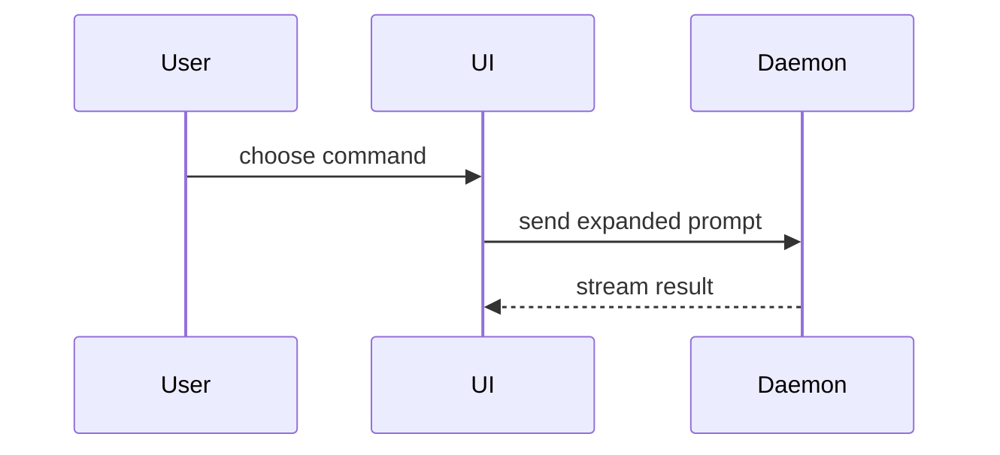

# View catalog

Decision table first; syntax sketches below. Pick **one** view that makes the point (a second
only for a distinct missing question). Provenance: distilled from `vendors/misc/eli5/SKILL.md`
(picture-first few-words register) and `vendors/misc/show-me/SKILL.md` (view forms) — read them
only to trace history; this file is the operative catalog.

| Question shape | View |
| --- | --- |
| Decision logic or algorithm | Pseudocode |
| In-process call order | Call tree |
| Multiple actors, timing, or data flow | Mermaid sequence/flow diagram |
| UI composition, state, or ownership | Component tree |
| File/module responsibility, broad refactor | Shallow file tree |
| Change to an existing known shape | Focused `diff` block |
| Mostly new, copyable target | Complete code/config block |
| Dense spatial layout/comparison the inline forms cannot express | One focused HTML artifact |

## Syntax sketches

Pseudocode — logic, not language:

```text
on(save)
  if content is unchanged
    return cached result
  write new content
  return fresh result
```

Call tree — who calls whom:

```text
submitForm
  createSession
    persistPrompt
    launchAgent
  navigateToSession
```

Component tree — composition, with state/module boundaries that matter:

```tsx
<SessionPage> (apps/example/src/routes/session.tsx)
  useSessionEvents()
  <SessionToolbar>
    <RunSkillButton> (packages/ui)
```

File tree — responsibilities at one level:

```text
src/
├── commands/       # parses user actions
├── sessions/       # owns session state
└── transport/      # sends API requests
```

Mermaid — interaction/timing across actors:



Diff — match its shape to the topic: component change, file-layout change, call-tree change, or
state/control-flow change:

```diff
 on(save)
-  write content
+  if content is unchanged
+    return cached result
+  write new content
+  invalidate cache
```

Copyable block — most of it is new, omitted context would hide ownership/order, or the user needs
a target shape to paste:

```ts
function expandSkill(command: string): string {
  const skillName = command.slice(1);
  return `use the ${skillName} skill`;
}
```

HTML artifact — last resort only. For a visual too dense for Mermaid (layout walk-through,
before/after comparison, short slide deck): one focused HTML file matching the product's colors,
type, spacing, and components; real labels and data; desktop + mobile. Open it and report the path.
